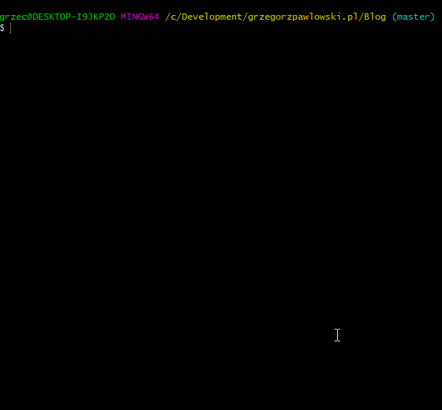

## Po co aliasy?

Po co to właściwie? Przecież nikt rozsądny nie będzie uczył się czegoś, co nie ma sensu.

Aliasy (albo bardziej po naszemu skróty) mają właściwie jedną kluczową zaletę – **są… krótsze**. Tak, są krótsze od poleceń, którym odpowiadają i to jest cała magia. A co z tego, że są krótsze?

#### Czas

Im mniej do wpisania, tym mniej czasu trzeba na to poświęcić. Proste drobne zwiększenie produktywności.

#### Bezbłędność

Ile razy zdarzyło Ci się wpisać `git checkot` zamiast `git checkout` lub popełnić inną podobną literówkę? Pisząc krócej, np. `gco`, zmniejszasz szansę na taki błąd.

## Jak?

Skoro dotarłeś tutaj, to znaczy, że widzisz w tym sens. Przejdźmy więc do konkretów!

Zobaczmy to na przykładzie polecenia:

```
git reset --hard origin/master
```

Żeby trochę to uprościć, chciałbym przypisać do tego alias `git rh`. Mogę to zrobić w konsoli:

```
git config --global alias.rh 'reset --hard origin/master'
```

Alias został dodany do konfiguracji Gita, którą możesz podejrzeć i edytować, wpisując:

```
git config --global --edit
```

Możesz też po prostu dopisywać kolejne aliasy w pliku konfiguracyjnym.



Są inne, ciekawsze i jeszcze bardziej przydatne sposoby na aliasy, ale wymagają nieco więcej pracy, więc opiszę je na blogu innym razem.

Aliasy można też wykorzystywać w innych sytuacjach, gdzie przydają się jeszcze bardziej, na przykład chcąc [zrobić porządek w repozytorium](../synchronizacja-i-porzadek-w-repozytorium/).

Polecam oczywiście zapoznać się z [dokumentacją aliasów](https://git-scm.com/book/en/v2/Git-Basics-Git-Aliases).

To był pierwszy wpis z serii Jest Git. Sprawdź pozostałe [tutaj](../category/git/)!
