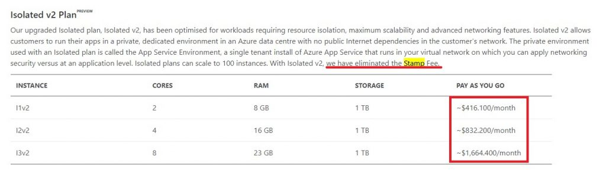

Azure Pricing Calculator to bardzo przydatne narzędzie, kiedy projektujesz rozwiązania z wykorzystaniem Azure i chciałbyś oszacować koszty utrzymania. Przydaje się także, kiedy tworzysz cokolwiek na Azurze, żeby sprawdzić, ile za to zapłacisz i co na ten koszt się składa. W skrócie, pomaga wyliczyć, ile rzeczywiście kosztuje Azure.

Kalkulator sam w sobie jest bardzo wygodny w użyciu. Po prostu wchodzimy na [stronę kalkulatora](https://azure.microsoft.com/en-gb/pricing/calculator/), dodajemy interesujące nas zasoby do wyliczenia, klikając na nie i dostosowujemy parametry (np. system operacyjny, region. ilość instancji itp.).

Mamy podsumowanie kosztów każdego zasobu oraz koszt sumaryczny na samym dole. Wyliczeniom można nadać nazwę – np. nazwą projektu. Dzięki temu można lepiej odnaleźć się przy kilku wyliczeniach. Można je też zapisać lub wyeksportować do Excela.

Teoretycznie, Azure Portal sam w sobie pokazuje koszty zasobu przy jego tworzeniu i są one także dostępne w [dokumentacji](https://azure.microsoft.com/en-gb/pricing/details/app-service/windows). Nie zawsze jednak, pokazana tam cena uwzględnia wszystkie koszty, a różnice w potrafią być znaczące.

Na przykład App Service w wersji *ISOLATED *(OS Windows, region West Europe), wg dokumentacji kosztuje ok $219 miesięcznie. Gdy wyliczymy taką konfigurację w Azure Pricing Calculator, zobaczymy kwotę $1347. Skromne $1128 różnicy.

Skąd aż taka różnica w cenie? Jeśli trochę uważniej zajrzeć do dokumentacji, to jest tam wyjaśnienie. “In addition to the price per Isolated plan instance, there is also a flat **Stamp Fee for each App Service Environment of $1.546/hour(~$1,128.360/month)**”. Cena $219, którą widać w porównaniu, to tylko cena instancji, bez *Stamp Fee*.

Microsoft chyba się zreflektował. W momencie, gdy piszę ten post pod koniec grudnia 2020, widzę, że dodano *Isolated v2 PlanPREVIEW*, W tym planie, według dokumentacji, wyeliminowano *Stamp Fee*. Plan nie jest jednak jeszcze dostępny w Kalkulatorze, więc nie mogę sprawdzić, jaki będzie koszt rzeczywisty.

Interesujesz się Azure? Już niedługo pojawią się kolejne wpisy w cyklu [Azure](/category/azure/)
