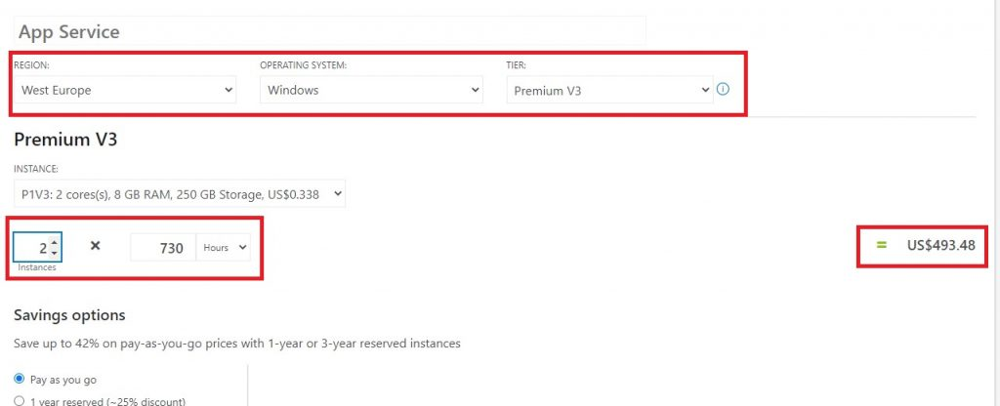
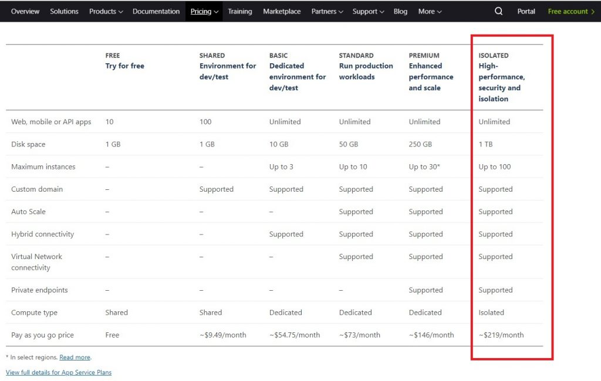
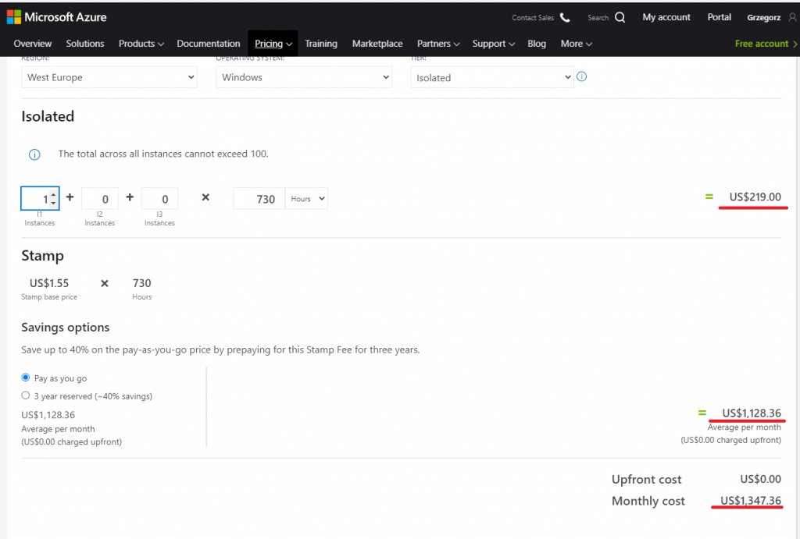

Azure Pricing Calculator to bardzo przydatne narzędzie, kiedy projektujesz rozwiązania z wykorzystaniem Azure i chciałbyś oszacować koszty utrzymania. Przydaje się także, kiedy tworzysz cokolwiek na Azurze, żeby sprawdzić, ile za to zapłacisz i co na ten koszt się składa. W skrócie, pomaga wyliczyć, ile rzeczywiście kosztuje Azure.

Kalkulator sam w sobie jest bardzo wygodny w użyciu. Po prostu wchodzimy na [stronę kalkulatora](https://azure.microsoft.com/en-gb/pricing/calculator/), dodajemy interesujące nas zasoby do wyliczenia, klikając na nie, i dostosowujemy parametry (np. system operacyjny, region, liczbę instancji itp.).

Mamy podsumowanie kosztów każdego zasobu oraz koszt sumaryczny na samym dole. Wyliczeniom można nadać nazwę – np. nazwę projektu. Dzięki temu można lepiej odnaleźć się przy kilku wyliczeniach. Można je też zapisać lub wyeksportować do Excela.

Teoretycznie Azure Portal sam w sobie pokazuje koszty zasobu przy jego tworzeniu i są one także dostępne w [dokumentacji](https://azure.microsoft.com/en-gb/pricing/details/app-service/windows/). Nie zawsze jednak pokazana tam cena uwzględnia wszystkie koszty, a różnice potrafią być znaczące.

W historycznym przykładzie App Service w wersji *ISOLATED* (OS Windows, region West Europe) wg ówczesnej dokumentacji kosztował ok. 219 USD miesięcznie. Wyliczenie tej konfiguracji w Azure Pricing Calculator pokazywało kwotę 1347 USD. Skromne 1128 USD różnicy. Tych kwot nie należy używać do dzisiejszych wycen.

Skąd aż taka różnica? Ówczesna dokumentacja wyjaśniała: “In addition to the price per Isolated plan instance, there is also a flat **Stamp Fee for each App Service Environment of $1.546/hour(~$1,128.360/month)**”. Cena $219 na historycznym zrzucie dotyczyła samej instancji, bez dawnego *Stamp Fee*.

Podczas przygotowania wpisu pod koniec grudnia 2020 r. pojawił się *Isolated v2 PlanPREVIEW* z innym modelem opłat, jeszcze niedostępny w moim ówczesnym widoku kalkulatora. Dzisiejsze zasady ASE v3 sprawdź w dokumentacji podanej u góry; brak starego Stamp Fee nie oznacza braku minimalnego kosztu środowiska.

Interesujesz się Azure? Już niedługo pojawią się kolejne wpisy w cyklu [Azure](../category/azure/).
