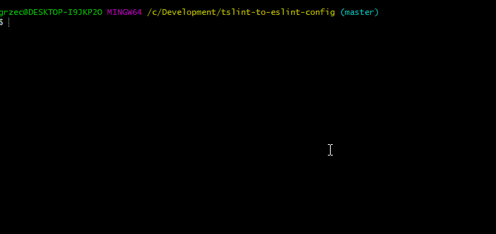

Zdarzyło Ci się kiedyś rozsynchronizować swoją gałąź z masterem tak, że najsensowniejszym wyjściem było ją usunąć i utworzyć nową? A jeśli do tego dochodzi brak synchronizacji lokalnej gałęzi z jej wersją na originie? Albo pomiędzy forkiem a upstreamem? Przyznam, że mnie się to zdarzało. Najlepszym rozwiązaniem jest oczywiście bardziej uważna praca z Gitem, żeby tego uniknąć, ale jeśli już jesteśmy w tej sytuacji, to kilka komend pozwoli zresetować naszą gałąź (lokalną i w originie) do dokładnie tego samego stanu, co master.

Jak to zrobić?

### Synchronizacja branch-master (brak forka)

Załóżmy, że nasza gałąź nazywa się **feature-1**.

1. Musisz być na tej gałęzi
2. Zaktualizuj repo
3. Kluczowy punkt – zresetuj stan gałęzi do mastera
4. Zresetuj gałąź na originie

```
git checkout feature-1
git fetch
git reset --hard origin/master
git push --force
```

### Synchronizacja upstream-fork

Tutaj pokażę to na przykładzie repozytorium *tslint-to-eslint-config*, z którego stworzyłem forka.

Dodałem jedną małą, ale bardzo ważną zmianę w Readme 😎


Jednocześnie trochę namieszałem 😱


A teraz jak z tego wybrnąć bez konieczności tworzenia forka od nowa?

Najpierw sprawdzam, cze mam poprawnie zdefiniowany origin: `git remote -v`. Powiniem zobaczyć coś takiego:



Robię zapasową gałąź, na której będą wszystkie commity, w tym super ważna zmiana w Readme.

```
git checkout -b backup-branch && git checkout master
```

Teraz, podobnie jak przy synchronizacji master-branch, resetuję mojego master do stanu upstreama

```
git fetch upstream master
git reset --hard upstream/master
git push --force
```

Na koniec jeszcze zbieram super ważnego commita z mojej zapasowej gałęzi.

```
git cherry-pick 4debd79a14d4776d5f098217c63b5886671c89de
```

Teraz mogę podejrzeć na GitHubie, czy udało się zrobić porządek.


### Bonus

Oczywiście zamiast pisać tyle komend, można to sobie opakować w skrypt i trzymać go pod aliasem, tak jak opisałem np. we wpisie [Alias w Gicie – jak i po co?](/alias-w-gicie-jak-i-po-co/).
