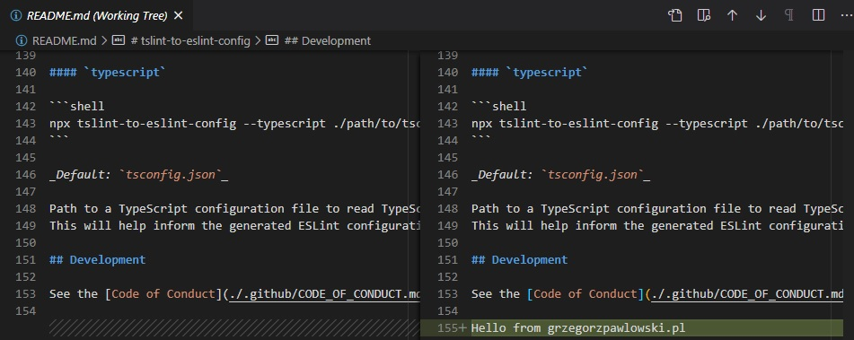
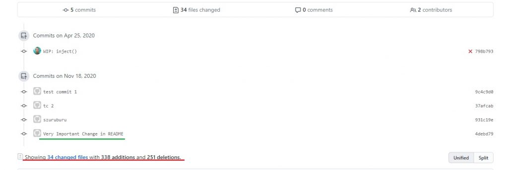
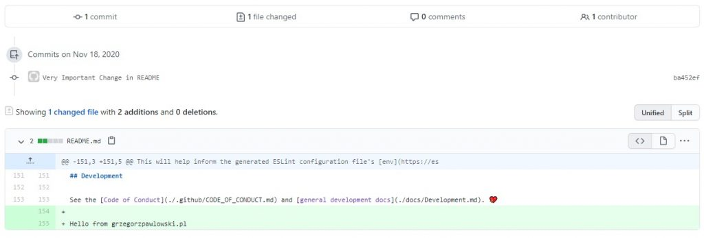

Zdarzyło Ci się kiedyś rozsynchronizować swoją gałąź z masterem tak, że najsensowniejszym wyjściem było ją usunąć i utworzyć nową? A jeśli do tego dochodzi brak synchronizacji lokalnej gałęzi z jej wersją na originie? Albo pomiędzy forkiem a upstreamem? Przyznam, że mnie się to zdarzało. Najlepszym rozwiązaniem jest oczywiście bardziej uważna praca z Gitem, żeby tego uniknąć, ale jeśli już jesteśmy w tej sytuacji, to kilka komend pozwoli zresetować naszą gałąź (lokalną i w originie) do dokładnie tego samego stanu, co master.

Jak to zrobić?

**Najpierw sprawdź, czy naprawdę chcesz nadpisać historię.** Jeżeli chcesz zachować zmiany z obu gałęzi, rozważ merge albo rebase, a nie reset. `git status --short` musi nie pokazywać zmian; w przeciwnym razie najpierw świadomie je zapisz. Gałąź zapasowa chroni commity, ale nie niezacommitowane pliki. `reset --hard` może także nadpisać nieśledzone pliki kolidujące z docelowym stanem. Nie wykonuj tych operacji na współdzielonej gałęzi bez uzgodnienia z zespołem.

### Synchronizacja branch-master (brak forka)

Załóżmy, że nasza gałąź nazywa się **feature-1**.

1. Przejdź na gałąź i upewnij się, że katalog roboczy jest czysty.
2. Pobierz aktualny stan serwera.
3. Utwórz gałąź zapasową pod nieużywaną nazwą i zapamiętaj SHA zdalnej gałęzi.
4. Dopiero wtedy zresetuj gałąź i wypchnij zmianę z kontrolą oczekiwanego SHA.

```bash
git checkout feature-1
git status --short
# Kontynuuj tylko, jeśli powyższe polecenie nic nie wypisało.
git fetch origin
git branch backup-feature-1
expected=$(git rev-parse origin/feature-1)
git reset --hard origin/master
git push --force-with-lease=refs/heads/feature-1:"$expected" origin HEAD:refs/heads/feature-1
```

Jeśli lease odrzuci push, nie obchodź go przez `--force`. Sprawdź nowe commity na serwerze i uzgodnij sposób ich zachowania. Polecenia wykonuj po kolei; po dowolnym błędzie przerwij.

### Synchronizacja upstream-fork

Tutaj pokażę to na przykładzie repozytorium *tslint-to-eslint-config*, z którego stworzyłem forka.

Dodałem jedną małą, ale bardzo ważną zmianę w Readme 😎



Jednocześnie trochę namieszałem 😱



A teraz jak z tego wybrnąć bez konieczności tworzenia forka od nowa?

Najpierw sprawdzam, czy mam poprawnie zdefiniowany origin: `git remote -v`. Powinienem zobaczyć coś takiego:


Robię zapasową gałąź, na której będą wszystkie commity, w tym superważna zmiana w README.

```bash
git checkout master
git status --short
# Kontynuuj tylko przy czystym katalogu roboczym.
git branch backup-master
git fetch origin
expected=$(git rev-parse origin/master)
```

Teraz, podobnie jak przy synchronizacji master-branch, resetuję mojego mastera do stanu upstreama:

```bash
git fetch upstream master
git reset --hard FETCH_HEAD
```

Na koniec jeszcze zbieram superważnego commita z mojej zapasowej gałęzi.

```bash
# Użyj SHA własnego commita odczytanego z backup-master.
git log --oneline backup-master
git cherry-pick SHA_COMMITA_DO_ZACHOWANIA
git push --force-with-lease=refs/heads/master:"$expected" origin HEAD:refs/heads/master
```

Zapis `SHA_COMMITA_DO_ZACHOWANIA` zastąp właściwym hashem; nie jest dosłownym argumentem. `FETCH_HEAD` powyżej oznacza wynik bezpośrednio poprzedzającego fetch — nie wykonuj między tymi poleceniami innego pobierania. Przy konfliktach najpierw je rozwiąż albo przerwij cherry-pick; nie przechodź do pushowania niegotowego stanu.

Teraz mogę podejrzeć na GitHubie, czy udało się zrobić porządek.



### Bonus

Oczywiście zamiast pisać tyle komend, można to sobie opakować w skrypt i trzymać go pod aliasem, tak jak opisałem np. we wpisie [Alias w Gicie – jak i po co?](../alias-w-gicie-jak-i-po-co/).
