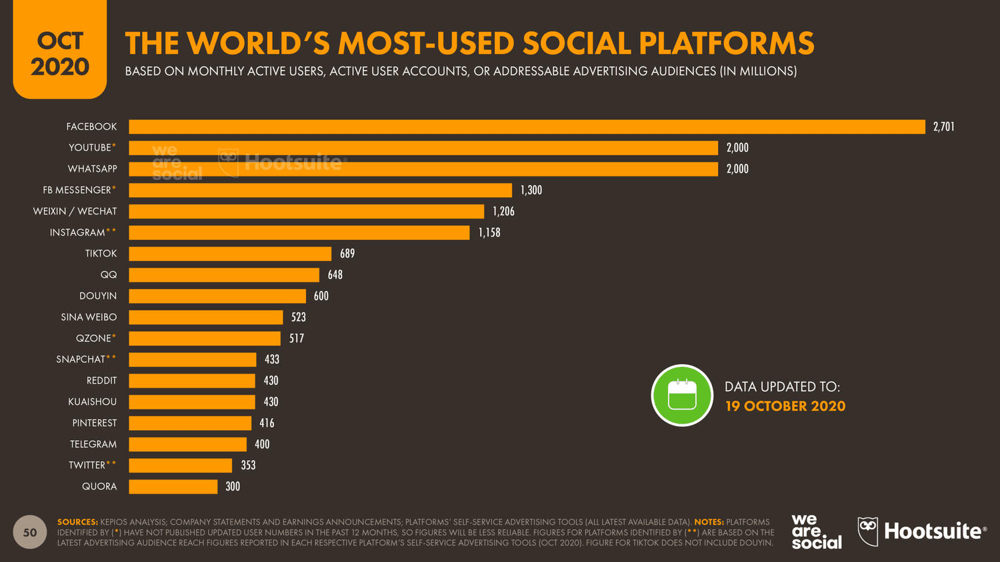
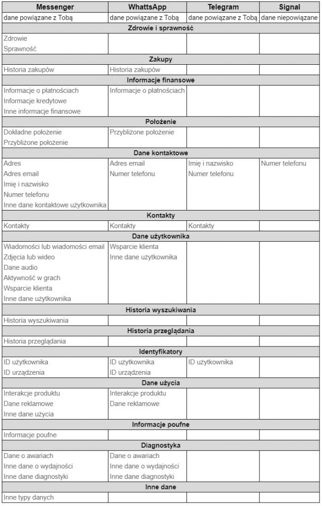

WhatsApp i Messenger należą do jednej grupy, znanej w chwili publikacji jako Facebook, a obecnie Meta. Dlaczego warto zastanowić się nad przynajmniej ograniczeniem zależności od jednego dostawcy? Jakie są alternatywy? Do porównania stają komunikatory: [Messenger](https://www.messenger.com/), [WhatsApp](https://www.whatsapp.com/), [Telegram](https://telegram.org/) i [Signal](https://signal.org/pl/).

Najpopularniejsze platformy społecznościowe (miesięczna liczba aktywnych użytkowników w milionach). Źródło: [DataReportal](https://datareportal.com/reports/digital-2020-october-global-statshot).

## Prywatność

Etykiety prywatności App Store pokazują deklarowane przez wydawców kategorie danych i cele ich przetwarzania. To nie niezależny audyt ani dowód, że każda instalacja zbiera wszystkie wymienione dane. Poniższe porównanie pochodzi z czasu publikacji w 2021 r.; aktualne etykiety i polityki trzeba sprawdzić osobno.

Rodzaje danych użytkownika, do których mogą mieć dostęp komunikatory. Źródło: [apps.apple.com](https://apps.apple.com/).

Po co aplikacja, która służy do wymiany wiadomości, rozmów audio i wideo, czy przesyłania zdjęć chciałaby mieć dostęp do historii przeglądania i wyszukiwania, danych o naszym zdrowiu, płatnościach i kredytach? Z podpowiedzią spieszy kolejna tabelka, pokazująca, do czego komunikatory używają naszych danych.

Do czego komunikatory używają danych użytkownika. Źródło: [apps.apple.com](https://apps.apple.com/).

Z tą wiedzą przechodzimy do kolejnego akapitu, żeby sprawdzić, kto tak naprawdę ma o nas tyle informacji.

## Niezależność

Jest takie powiedzenie: „Jeśli coś jest za darmo, to Ty jesteś produktem”. To przestroga, nie uniwersalna reguła — darmową usługę można finansować także z darowizn. Dane o aktywności mogą służyć profilowaniu reklamowemu, ale etykieta prywatności nie dowodzi konkretnej metody profilowania. Dawny przykład o odczytywaniu przez Facebooka emocji z twarzy podczas wizyty w banku nie miał tu potwierdzenia i go usuwam.

Sprawdźmy, do kogo należą i kto tworzy poszczególne komunikatory.

#### Messenger

Komunikator należy do grupy Meta, wcześniej znanej jako Facebook, Inc., podobnie jak WhatsApp i Instagram.

#### WhatsApp

Właścicielem tego komunikatora także jest Facebook, który kupił go w 2014 r. Sam WhatsApp został założony w 2009 r. przez Briana Actona i Jana Kuma – byłych pracowników Yahoo!

#### **Telegram**

Aplikacja autorstwa Telegram FZ-LLC. Telegram został stworzony przez Mikołaja i Pawła Durowów – dwóch Rosjan, autorów między innymi popularnego na wschodzie serwisu społecznościowego [VKontakte](https://vk.com/). Paweł został odwołany z funkcji CEO VKontakte po odmowie przekazania danych użytkowników państwowym służbom. Stanowczo opowiada się przeciw cenzurze. Zespół Telegrama opuścił Rosję ze względu na niekorzystne regulacje dotyczące rynku IT i aktualnie pracuje w Dubaju. Aplikacje Telegrama są open-source (kod jest otwarty i publicznie dostępny), ale sam kod i sposób jego udostępnienia są krytykowane.

#### **Signal**

Signal jest rozwijany w ramach organizacji non-profit. Signal Foundation założyli w 2018 r. Moxie Marlinspike i Brian Acton, współzałożyciel WhatsAppa. Kod Signala jest publicznie dostępny na [GitHubie](https://github.com/signalapp), co umożliwia niezależną analizę. Open source nie gwarantuje jednak braku błędów ani zgodności każdej uruchomionej instancji ze źródłem. Model finansowania opiera się na wsparciu organizacji, a nie sprzedaży reklam.

#### Cenzura

Niezależność to również możliwość zachowania kontaktu po blokadzie konta, awarii albo zmianie regulaminu. Błędy moderacji mogą się zdarzać, ale dawne przykłady zdań rzekomo automatycznie powodujących bana nie były tu udokumentowane. Warto mieć alternatywny kanał kontaktu i rozumieć procedurę odzyskiwania konta u każdego dostawcy.

## Bezpieczeństwo

Istnieje kilka zagrożeń przy korzystaniu z komunikatorów internetowych. Co może się stać i jakie jest ryzyko przy poszczególnych komunikatorach?

### Włamanie na Twoje konto i dostęp do komunikatora

Na taki atak podatni są użytkownicy Messengera, do którego można się zalogować kontem na Facebooku. Podobne zagrożenie występuje przy innych komunikatorach, jednak tam nie jest to wspólne konto z innym serwisem.

### Przechwycenie danych podczas wysyłania i odbierania (podsłuch)

Szyfrowanie transportowe chroni połączenie z serwerem; **E2EE** chroni treść pomiędzy urządzeniami rozmówców także przed pośredniczącym serwerem. Signal i WhatsApp używają E2EE domyślnie w prywatnych rozmowach. Meta ogłosiła wdrażanie domyślnego E2EE dla osobistych wiadomości i połączeń Messengera w grudniu 2023 r.; sprawdzaj oznaczenia i wyjątki dla konkretnego rodzaju rozmowy.

Zwykłe czaty i grupy tekstowe Telegrama są szyfrowane klient–serwer, **nie end-to-end**. E2EE wiadomości jest dostępne w indywidualnych tajnych czatach, które nie synchronizują się jak czaty chmurowe. Nie należy utożsamiać grup tekstowych z osobno obsługiwanymi połączeniami E2EE. Dokumentacja MTProto i kod klientów są publiczne; kod serwerowy Telegrama nie jest w całości otwarty.

Signal minimalizuje zatrzymywane metadane i rozwija mechanizmy takie jak sealed sender. Nie oznacza to całkowitego ukrycia IP, czasu komunikacji czy odporności na analizę ruchu. E2EE nie chroni też przed rozmówcą, który skopiuje wiadomość, ani przed przejętym urządzeniem.

### Włamanie na telefon i dostęp do komunikatora

Dostęp niepożądanej osoby do odblokowanego telefonu może pozwolić na odczyt wiadomości mimo E2EE. Ochrona danych lokalnych zależy od systemu, wersji aplikacji, blokady urządzenia, kopii i eksportów. Nie ma podstaw do ogólnego twierdzenia, że Signal szyfruje „wszystko”, a WhatsApp nic. Aktualizuj system i aplikacje, używaj mocnej blokady oraz sprawdzaj podłączone urządzenia.

### Włamanie na serwery wydawcy komunikatora – wyciek danych i/lub wiadomości użytkownika

Wycieki danych się zdarzają – nawet firmom, które użytkownicy uważali za godne zaufania – bo to przecież „poważna firma i nie pozwoli sobie na wpadki”. A jednak w ostatnich latach wyciekły dane z takich firm jak Marriott, CouchSurfing, British Airways, Yahoo, Uber, Morele.net, Twitter, GitHub, LinkedIn i… Facebook. Wykradzione dane mogą zawierać adres e-mail i hasło, ale także inne dane gromadzone na serwerach firmy.

Porównanie po korekcie (dotyczy głównie prywatnych wiadomości, nie każdej funkcji produktu):

| Funkcja | Messenger | WhatsApp | Telegram | Signal |
| --- | --- | --- | --- | --- |
| E2EE wiadomości | Domyślne dla osobistych rozmów; sprawdź rodzaj czatu | Domyślne w prywatnych rozmowach | Tylko indywidualne tajne czaty | Domyślne |
| E2EE grup tekstowych | Dla obsługiwanych osobistych rozmów E2EE | Tak | Nie | Tak |
| Historia i kopie | Zabezpieczone przechowywanie historii; sprawdź odzyskiwanie | Opcjonalne kopie E2EE — sprawdź ustawienia | Czaty chmurowe nie mają E2EE; tajne czaty są związane z urządzeniem | Opcjonalne Secure Backups z E2EE ogłoszone w 2025 r.; dostępność zależy od wersji/platformy |
| Korzystanie na wielu urządzeniach | Tak | Tak | Tak dla czatów chmurowych | Tak przez urządzenia powiązane |

Synchronizacja historii to nie to samo co kopia zapasowa. E2EE rozmowy nie gwarantuje automatycznie E2EE każdego eksportu lub backupu. Zabezpiecz klucz odzyskiwania i sprawdź aktualne instrukcje konkretnej aplikacji.

### Podsumowanie

Nadal preferuję Signala ze względu na domyślne E2EE i podejście do minimalizacji danych. Nie oznacza to anonimowości ani odporności na każde zagrożenie. Sama przesiadka z WhatsAppa na zwykły czat Telegrama nie poprawia ochrony treści przed operatorem — traci się wtedy E2EE. Dobierz komunikator do zagrożeń, ustawień kopii i możliwości rozmówców, zamiast polegać na jednej tabeli „bezpieczny/niebezpieczny”.

#### Źródła

- [iGeeksBlog – WhatsApp vs Signal (kopia archiwalna)](https://web.archive.org/web/20210118050717/https://www.igeeksblog.com/whatsapp-vs-signal/)
- [https://beebom.com/whatsapp-vs-telegram-vs-signal/](https://beebom.com/whatsapp-vs-telegram-vs-signal/)
- [https://www.vida.pl/najgrozniejsze-ataki-hakerskie-i-najwieksze-wycieki-danych-w-2020-r/](https://www.vida.pl/najgrozniejsze-ataki-hakerskie-i-najwieksze-wycieki-danych-w-2020-r/)
- [PC World – Największe kary za wycieki danych (kopia archiwalna)](https://web.archive.org/web/20191121191106/https://www.pcworld.pl/news/Najwieksze-kary-za-wycieki-danych,414679.html)
- [https://avlab.pl/najwieksze-wycieki-danych-i-zmasowane-ataki-ostatnich-lat/](https://avlab.pl/najwieksze-wycieki-danych-i-zmasowane-ataki-ostatnich-lat/)
- [https://securetechcongress.pl/najwieksze-wycieki-danych-na-swiecie-2018/](https://securetechcongress.pl/najwieksze-wycieki-danych-na-swiecie-2018/)
- [https://hsm-recycling.pl/pl/blog/najwieksze-wycieki-danych-w-historii-4/](https://hsm-recycling.pl/pl/blog/najwieksze-wycieki-danych-w-historii-4/)
- [https://nerdschalk.com/facebook-messenger-end-to-end-encryption/](https://nerdschalk.com/facebook-messenger-end-to-end-encryption/)
- [JatApp – Telegram open-source pitfalls (kopia archiwalna)](https://web.archive.org/web/20211203014141/https://jatapp.com/blog/telegram-open-source-pitfalls/)
