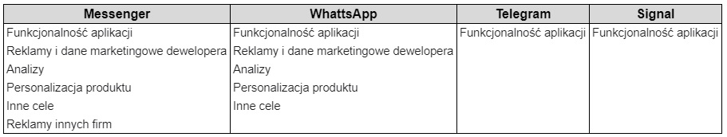

Facebook monopolizuje nie tylko media społecznościowe, ale też komunikację przez internet. WhatsApp i Messenger to czołówka popularności, a oba należą do Facebooka. Dlaczego warto zastanowić się nad przynajmniej ograniczeniem korzystania z nich? Jakie są alternatywy? Do porównania stają komunikatory: [Messenger](https://www.messenger.com/), [WhatsApp](https://www.whatsapp.com/), [Telegram](https://telegram.org/) i [Signal](https://signal.org/pl/).

Najpopularniejsze platformy społecznościowe (miesięczna liczba aktywnych użytkowników w milionach). Źródło: [DataReportal](https://datareportal.com/reports/digital-2020-october-global-statshot).

## Prywatność

Mało kto zdaje sobie sprawę z tego, do jak wielu danych o nas ma dostęp Facebook, jeśli używamy na co dzień 2–3 aplikacji tej firmy. Dzięki wprowadzonej niedawno przez Apple funkcjonalności można sprawdzić, jakie to dane i do czego są wykorzystywane. W tabelce poniżej porównanie dla tytułowej czwórki.

Rodzaje danych użytkownika, do których mogą mieć dostęp komunikatory. Źródło: [apps.apple.com](https://apps.apple.com/).

Po co aplikacja, która służy do wymiany wiadomości, rozmów audio i wideo, czy przesyłania zdjęć chciałaby mieć dostęp do historii przeglądania i wyszukiwania, danych o naszym zdrowiu, płatnościach i kredytach? Z podpowiedzią spieszy kolejna tabelka, pokazująca, do czego komunikatory używają naszych danych.

Do czego komunikatory używają danych użytkownika. Źródło: [apps.apple.com](https://apps.apple.com/).

Z tą wiedzą przechodzimy do kolejnego akapitu, żeby sprawdzić, kto tak naprawdę ma o nas tyle informacji.

## Niezależność

Jest takie powiedzenie: „Jeśli coś jest za darmo, to Ty jesteś produktem”. W tym przypadku produktem są nasze dane. Dzięki takiej ilości danych, ich posiadacz może Cię profilować – dowiedzieć się, co lubisz, z kim się spotykasz, jaką masz osobowość, poglądy, w jakim jesteś nastroju, gdzie pracujesz, co kupujesz. To bardzo cenne przy doborze reklam. Przykładowo, Facebook, wiedząc że jesteś akurat w dobrym nastroju, a gdy odwiedzałeś stronę swojego banku analiza obrazu rozpoznała na twojej twarzy satysfakcję, w dodatku spotkałeś ostatnio osobę, którą bardzo lubisz i która ostatnio kupiła nowe buty, wyświetli Ci reklamę tych butów. Szansa, że je kupisz, jest wtedy większa. „Wielki Brat” zna Cię dobrze.

Sprawdźmy, do kogo należą i kto tworzy poszczególne komunikatory.

#### Messenger

Wydawcą jest firma Facebook, Inc. – właściciel portalu społecznościowego Facebook. Jest także właścicielem aplikacji WhatsApp i Instagram.

#### WhatsApp

Właścicielem tego komunikatora także jest Facebook, który kupił go w 2014 r. Sam WhatsApp został założony w 2009 r. przez Briana Actona i Jana Kuma – byłych pracowników Yahoo!

#### **Telegram**

Aplikacja autorstwa Telegram FZ-LLC. Telegram został stworzony przez Mikołaja i Pawła Durowów – dwóch Rosjan, autorów między innymi popularnego na wschodzie serwisu społecznościowego [VKontakte](https://vk.com/). Paweł został odwołany z funkcji CEO VKontakte po odmowie przekazania danych użytkowników państwowym służbom. Stanowczo opowiada się przeciw cenzurze. Zespół Telegrama opuścił Rosję ze względu na niekorzystne regulacje dotyczące rynku IT i aktualnie pracuje w Dubaju. Aplikacje Telegrama są open-source (kod jest otwarty i publicznie dostępny), ale sam kod i sposób jego udostępnienia są krytykowane.

#### **Signal**

Rozwijany przez Signal Foundation – amerykańską organizację non-profit założoną w 2018 r. przez Moxie Marlinspike’a i Briana Actona, który był współzałożycielem WhatsAppa i opuścił go po przejęciu komunikatora przez Facebooka. Kod Signala jest publicznie dostępny na [GitHubie](https://github.com/signalapp) – jest to aplikacja open-source. To ważne, bo wiadomo, że Signal niczego nie ukrywa przed użytkownikami – można dokładnie sprawdzić, jak działa. Signal Foundation utrzymuje się jedynie z dobrowolnych darowizn i grantów.

#### Cenzura

Niezależność to też brak Twojej zależności od aplikacji. W tym przypadku szczególnie groźny jest monopol Facebooka. Wyobraź sobie, że nagle tracisz dostęp do wszystkich wiadomości na Messengerze, bo np. Facebook zbanował Twoje konto. Tak, jest takie ryzyko – wystarczy, że napiszesz, że kupiłeś ostatnio pedały do roweru i masz o nich złą opinię albo w dyskusji o przepisie na murzynka napiszesz, że biała czekolada jest lepsza. Algorytm Facebooka uzna, że obrażasz ludzi i jesteś groźny dla społeczeństwa. I co zrobisz? Nic nie zrobisz? Jeśli można zablokować prezydenta USA, to czemu nie przeciętnego Polaka? Lepiej nie być zależnym od jednej firmy.

## Bezpieczeństwo

Istnieje kilka zagrożeń przy korzystaniu z komunikatorów internetowych. Co może się stać i jakie jest ryzyko przy poszczególnych komunikatorach?

### Włamanie na Twoje konto i dostęp do komunikatora

Na taki atak podatni są użytkownicy Messengera, do którego można się zalogować kontem na Facebooku. Podobne zagrożenie występuje przy innych komunikatorach, jednak tam nie jest to wspólne konto z innym serwisem.

### Przechwycenie danych podczas wysyłania i odbierania (podsłuch)

Podstawowe zabezpieczenie przed tym zagrożeniem to szyfrowana komunikacja – E2EE (end-to-end encryption). Również w tym przypadku Signal wybija się na tle konkurencji – szyfrowane są nie tylko wiadomości, ale i metadane (kto z kim rozmawia, kiedy, skąd itp.). Signal i WhatsApp mają przewagę nad Telegramem w kwestii szyfrowania rozmów grupowych, których ten ostatni nie szyfruje. Kolejnego minusa można przyznać Telegramowi za to, że szyfrowanie nie jest włączone domyślnie – działa tylko w trybie „tajnych czatów” – podobnie jak w przypadku Messengera. Co więcej, mechanizmy szyfrowania Telegrama, w przeciwieństwie do Signala, nie są open-source, więc możliwość ich niezależnej weryfikacji jest mocno ograniczona.

### Włamanie na telefon i dostęp do komunikatora

Dostęp niepożądanej osoby do telefonu oznacza dużo poważniejsze kłopoty niż tylko odczytanie wiadomości. Istotne jest, aby dane w pamięci telefonu nie były łatwo dostępne – aby też były zaszyfrowane. Signal szyfruje wszystkie dane i pliki przechowywane na urządzeniu, w przeciwieństwie do WhatsAppa.

### Włamanie na serwery wydawcy komunikatora – wyciek danych i/lub wiadomości użytkownika

Wycieki danych się zdarzają – nawet firmom, które użytkownicy uważali za godne zaufania – bo to przecież „poważna firma i nie pozwoli sobie na wpadki”. A jednak w ostatnich latach wyciekły dane z takich firm jak Marriott, CouchSurfing, British Airways, Yahoo, Uber, Morele.net, Twitter, GitHub, LinkedIn i… Facebook. Wykradzione dane mogą zawierać adres e-mail i hasło, ale także inne dane gromadzone na serwerach firmy.

Porównanie bezpieczeństwa (przepisane z ilustracji do czytelnej tabeli):

| Funkcja | Messenger | WhatsApp | Telegram | Signal |
| --- | --- | --- | --- | --- |
| Szyfrowanie E2E | Tylko „tajne czaty” | Domyślne | Tylko „tajne czaty” | Domyślne |
| Szyfrowanie wiadomości grupowych | Nie | Tak | Nie | Tak |
| Szyfrowanie metadanych | Nie | Nie | Nie | Tak |
| Szyfrowanie danych na urządzeniu | ? | Nie | Nie | Tak |
| Kopia zapasowa na serwerach | Tak | Tak | Tak | Nie |
| Szyfrowanie kopii zapasowej | ? | Nie | Tylko „tajne czaty” | Nie dotyczy |
| Dostęp z innej platformy | Tak | Nie | Nie | Nie |
| Mechanizmy szyfrowania open-source | Nie | Tak | Nie | Tak |

### Podsumowanie

Pod kątem prywatności, bezpieczeństwa i zaufania, te cztery komunikatory na pewno się różnią. Mam nadzieję, że udało mi się te różnice wyjaśnić i przedstawić. Celowo nie wspominałem o funkcjach poszczególnych aplikacji, bo wszystkie spełniają swoje zadanie jako komunikatory, w tym do rozmów grupowych, audio i wideo oraz przesyłania plików, zdjęć itp. Czy wniosek z tego tekstu jest taki, żeby porzucić Messengera lub WhatsAppa i zmienić go na Telegrama lub Signala? W skrócie, tak! Od jakiegoś czasu używam głównie Signala, którego wybrałem ze względu na podejście do prywatności i niezależność. Czy każdemu bym go polecił? Każdemu, komu bardziej zależy na własnym bezpieczeństwie, prywatności, anonimowości i niezależności niż na bajerach, przyzwyczajeniu i względnej wygodzie.

#### Źródła

- [iGeeksBlog – WhatsApp vs Signal (kopia archiwalna)](https://web.archive.org/web/20210118050717/https://www.igeeksblog.com/whatsapp-vs-signal/)
- [https://beebom.com/whatsapp-vs-telegram-vs-signal/](https://beebom.com/whatsapp-vs-telegram-vs-signal/)
- [https://www.vida.pl/najgrozniejsze-ataki-hakerskie-i-najwieksze-wycieki-danych-w-2020-r/](https://www.vida.pl/najgrozniejsze-ataki-hakerskie-i-najwieksze-wycieki-danych-w-2020-r/)
- [PC World – Największe kary za wycieki danych (kopia archiwalna)](https://web.archive.org/web/20191121191106/https://www.pcworld.pl/news/Najwieksze-kary-za-wycieki-danych,414679.html)
- [https://avlab.pl/najwieksze-wycieki-danych-i-zmasowane-ataki-ostatnich-lat/](https://avlab.pl/najwieksze-wycieki-danych-i-zmasowane-ataki-ostatnich-lat/)
- [https://securetechcongress.pl/najwieksze-wycieki-danych-na-swiecie-2018/](https://securetechcongress.pl/najwieksze-wycieki-danych-na-swiecie-2018/)
- [https://hsm-recycling.pl/pl/blog/najwieksze-wycieki-danych-w-historii-4/](https://hsm-recycling.pl/pl/blog/najwieksze-wycieki-danych-w-historii-4/)
- [https://nerdschalk.com/facebook-messenger-end-to-end-encryption/](https://nerdschalk.com/facebook-messenger-end-to-end-encryption/)
- [JatApp – Telegram open-source pitfalls (kopia archiwalna)](https://web.archive.org/web/20211203014141/https://jatapp.com/blog/telegram-open-source-pitfalls/)
