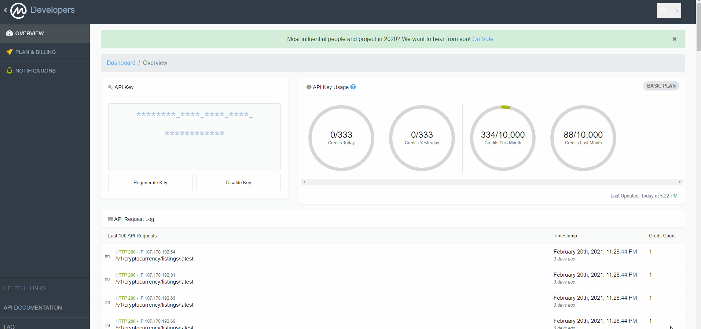

Kolejny skrypt rozszerzający funkcjonalność Arkuszy Google przy wykorzystaniu ich do monitorowania finansów przyda się inwestującym w kryptowaluty. To funkcja `CRYPTO_USD_PRICE`, która zwraca cenę danej kryptowaluty w dolarach według kursu [CoinMarketCap](https://coinmarketcap.com/) (jedna z najpopularniejszych stron z kursami).

Co prawda, ceny najpopularniejszych krypto jak BTC i ETH można pobrać korzystając z `GOOGLEFINANCE`, ale jeśli masz jakieś mniej popularne altcoiny, nie uda Ci się. Dzięki tej funkcji w praktyce, możesz pobrać cenę każdej kryptowaluty, która jest dostępna na CoinMarketCap.

#### Jak jej używać?

Po pierwsze, potrzebujesz klucza API CoinMarketCap – to sposób, w jaki zabezpieczają swoje API przed przeciążeniem zbyt dużą liczbą zapytań. Zdobycie klucza jest bezproblemowe:

1. Wchodzisz na [stronę rejestracji API CoinMarketCap](https://pro.coinmarketcap.com/signup) i zakładasz konto.
2. Po założeniu konta logujesz się i wchodzisz na [pro.coinmarketcap.com/account](https://pro.coinmarketcap.com/account) .
3. Po najechaniu kursorem (jak na poniższym gifie) zobaczysz swój API Key i będziesz mógł go skopiować.



Następnie klucz trzeba podmienić w kodzie, który musisz skopiować do edytora skryptów w Arkuszach Google tak, jak to opisałem we wpisie **[Google Sheets #3: Jak Używać Funkcji](/jak-uzywac-funkcji-thesaurus/)**

Mając to wszystko, wystarczy podać ticker (symbol danej kryptowaluty, który znajdziesz na CoinMarketCap – zaznaczony na obrazku poniżej) jako argument, np. :

```
=CRYPTO_USD_PRICE("BTC")
```


Jak zawsze, kod znajdziesz [na GitHubie](https://github.com/GrzesiekP/Thesaurus). Jeśli chcesz poczytać o kryptowalutach dla początkujących, sprawdź serię [Krypto Dla Leniwych](/category/kryptowaluty/), gdzie staram się w prosty sposób przekazać to, co najważniejsze w temacie.
