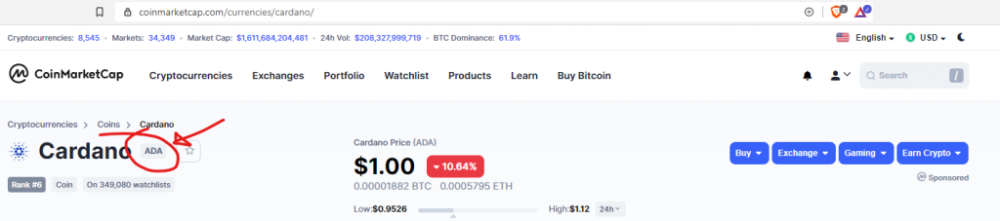

Kolejny skrypt rozszerzający funkcjonalność Arkuszy Google przy wykorzystaniu ich do monitorowania finansów przyda się inwestującym w kryptowaluty. To funkcja `CRYPTO_USD_PRICE`, która zwraca cenę danej kryptowaluty w dolarach według kursu [CoinMarketCap](https://coinmarketcap.com/) (jedna z najpopularniejszych stron z kursami).

Obsługa konkretnej pary w `GOOGLEFINANCE` zależy od dostępności danych i może się zmieniać. Własna funkcja daje możliwość integracji z innym dostawcą, ale też nie gwarantuje dostępu do każdej kryptowaluty. Historyczna implementacja pobierała odpowiedź `listings/latest` i szukała w niej symbolu. Jeśli danego aktywa nie było w zwróconej liście, kończyła się błędem. Symbole nie zawsze są unikalne; w nowej integracji lepiej korzystać z jednoznacznych ID/sluga i endpointu odpowiadającego danemu planowi API.

#### Jak jej używać?

Historyczna implementacja wymagała klucza API CoinMarketCap, służącego identyfikacji dostępu i rozliczaniu limitów planu. Aktualne API ma również odrębne opcje dostępu bez klucza; nie oznacza to, że stary kod automatycznie z nich skorzysta. Dawna procedura wyglądała tak:

1. Wchodzisz na [stronę rejestracji API CoinMarketCap](https://pro.coinmarketcap.com/signup) i zakładasz konto.
2. Po założeniu konta logujesz się i wchodzisz do [panelu API CoinMarketCap](https://coinmarketcap.com/api/dashboard/).
3. Po najechaniu kursorem (jak na poniższym gifie) zobaczysz swój API Key i będziesz mógł go skopiować.


Następnie klucz trzeba podmienić w kodzie, który musisz skopiować do edytora skryptów w Arkuszach Google tak, jak to opisałem we wpisie **[Google Sheets #3: Jak używać funkcji](../jak-uzywac-funkcji-thesaurus/)**.

Mając to wszystko, wystarczy podać ticker (symbol danej kryptowaluty, który znajdziesz na CoinMarketCap – zaznaczony na obrazku poniżej) jako argument, np.:

```
=CRYPTO_USD_PRICE("BTC")
```



Kod opisanej wersji znajdziesz [na GitHubie w przypiętym commicie](https://github.com/GrzesiekP/Thesaurus/blob/ec6600ee2090bfd0cb1e00055e1dcef49277d665/Thesaurus.js). Przed użyciem do bieżących wycen sprawdź obsługę błędów HTTP/API, limitów, pustej odpowiedzi i czasu odświeżenia. Jeśli chcesz poczytać o kryptowalutach dla początkujących, sprawdź serię [Krypto dla leniwych](../category/kryptowaluty/).
