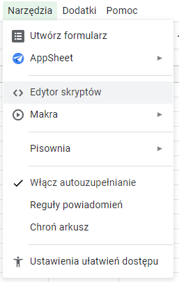

Thesaurus (z łaciny skarbiec) – tak roboczo nazwałem projekt, w którym zebrałem kilka funkcji do używania przy monitorowaniu finansów w Arkuszach Google. W innych wpisach pokazywałem konkretne funkcje, ale teraz postanowiłem opublikować wszystkie skrypty w jednym pliku i opisać, jak z nich skorzystać – tak, żeby było to jak najłatwiejsze. Jest to prosta instalacja typu „copy-paste” 😎. Mam nadzieję, że uda Ci się wyciągnąć z tego projektu coś, czym kupisz sobie czas, wygodę i przejrzystość w monitorowaniu własnego skarbca.

#### Czego potrzebujesz?

- Kodu wersji opisanej we wpisie – znajdziesz go [w przypiętym commicie na GitHubie](https://github.com/GrzesiekP/Thesaurus/blob/ec6600ee2090bfd0cb1e00055e1dcef49277d665/Thesaurus.js).
- Do działania funkcji `CRYPTO_USD_PRICE` (opisałem ją we wpisie [Google Sheets #4: Cena kryptowaluty w Arkuszach Google](../cena-kryptowaluty-w-arkuszach-google/)) potrzebujesz klucza API CoinMarketCap (strony z kursami kryptowalut). Opis, jak go zdobyć, również znajdziesz we [wspomnianym wpisie](../cena-kryptowaluty-w-arkuszach-google/).

#### Instrukcja:

1. Otwórz edytor przez **Rozszerzenia → Apps Script**. Na historycznym zrzucie poniżej jest dawna ścieżka **Narzędzia → Edytor skryptów**.



2. Pojawi się kod skryptu ***Kod.gs***. Po przejrzeniu źródła zamień go na kod z [historycznej wersji *Thesaurus.js*](https://github.com/GrzesiekP/Thesaurus/blob/ec6600ee2090bfd0cb1e00055e1dcef49277d665/Thesaurus.js). Uwaga: odtwarza ona dawny przykład, nie gwarantuje działania nieaktualnych dostawców danych.


3. Podmień w pierwszej linijce wartość `coinMarketCapApiKey` – zamiast `apiKey` wklej swój klucz API CoinMarketCap (**[skąd go wziąć?](../cena-kryptowaluty-w-arkuszach-google/)**) i kliknij ikonę zapisu, np.:

```
const coinMarketCapApiKey = "WKLEJ_WLASNY_KLUCZ";
```

4. W przypadku uruchamiania funkcji w edytorze może być potrzebna autoryzacja odpowiednich usług. Poniższe kroki i animacja ilustrują dawny ekran zgód. Sama funkcja niestandardowa wywołana z komórki nie wyświetla okna autoryzacji i nie może korzystać z dowolnych usług wymagających dostępu do danych użytkownika.

5. W górnym menu powinna być wybrana funkcja `THESAURUS_AVAILABLE`.

6. Kliknij ***Uruchom***, następnie ***Przejrzyj Uprawnienia***

7. Wybierz swoje konto Google.

8. Jeśli zobaczysz ostrzeżenie o niezweryfikowanej aplikacji, zatrzymaj się i sprawdź kod oraz żądane uprawnienia. To, że sam jesteś właścicielem skopiowanego projektu, nie oznacza, że cudzy kod jest bezpieczny.

9. Przejdź dalej tylko wtedy, gdy rozumiesz i akceptujesz dostęp, o który prosi projekt. „Projekt bez nazwy” to nazwa, którą możesz zmienić, a nie potwierdzenie zaufania.

10. Kliknij ***Zezwól***


**Tak wyglądało uruchomienie historycznej wersji.** Do bieżącego użycia trzeba jeszcze sprawdzić dostępność dostawców, poprawność wyników i zgodność skryptu z limitami. Samo udzielenie zgód nie potwierdza działania funkcji.

Dokumentację i opis funkcji znajdziesz [na GitHubie](https://github.com/GrzesiekP/Thesaurus) oraz w innych wpisach z [serii Google Sheets](../category/google-sheets/).
