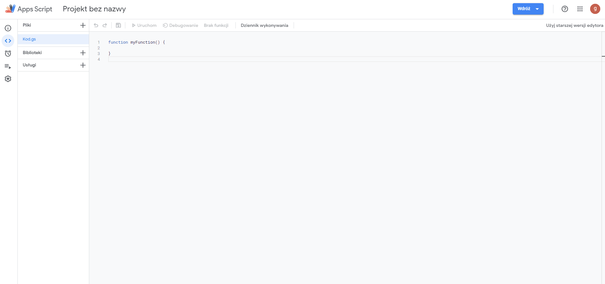
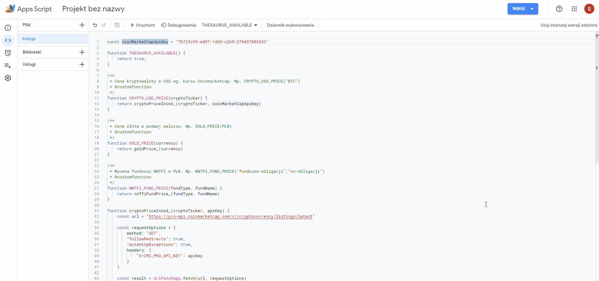

Thesaurus (z łaciny skarbiec) – tak roboczo nazwałem projekt, w którym zebrałem kilka funkcji do używania przy monitorowaniu finansów w Arkuszach Google. W innych wpisach pokazywałem konkretne funkcje, ale teraz postanowiłem opublikować wszystkie skrypty w jednym pliku i opisać, jak z nich skorzystać – tak, żeby było to jak najłatwiejsze. Jest to prosta instalacja typu 'copy-paste’  😎.  Mam nadzieję, że uda Ci się wyciągnąć z tego projektu coś, czym kupisz sobie czas, wygodę i przejrzystość w monitorowaniu własnego skarbca.

#### Czego potrzebujesz?

- Kodu – znajdziesz go [na GitHubie](https://github.com/GrzesiekP/Thesaurus/blob/master/Thesaurus.js) .
- Do działania funkcji `CRYPTO_USD_PRICE` (opisałem we wpisie [Google Sheets #4: Cena Kryptowaluty w Arkuszach Google](/cena-kryptowaluty-w-arkuszach-google/) ) potrzebujesz klucz API CoinMarketCap (strona z kursami kryptowalut). Opis, jak go zdobyć również znajdziesz we [wspomnianym wpisie](/cena-kryptowaluty-w-arkuszach-google/) .

#### Instrukcja:

1. Otwórz ***Edytor Skryptów*** (Narzędzia -> Edytor Skryptów)


2. Pojawi się kod skryptu ***Kod.gs***. Zamień go na kod z pliku [*Thesaurus.js* z GitHuba](https://github.com/GrzesiekP/Thesaurus/blob/master/Thesaurus.js).



3. Podmień w pierwszej linijce wartość `coinMarketCapApiKey`– zamiast `apiKey`wklej swój klucz API CoinMarketCap (**[skąd go wziąć?](/cena-kryptowaluty-w-arkuszach-google/)**) i kliknij ikonę zapisu, np.

```
const coinMarketCapApiKey = "7b725c99-ed97-1dd8-c2b5-278d97885393"
```

4. Musisz jeszcze uruchomić pierwszy raz funkcję, żeby ustawić uprawnienia.

5. W górnym menu powinna być wybrana funkcja `THESAURUS_AVAILABLE`.

6. Kliknij ***Uruchom***, następnie ***Przejrzyj Uprawnienia***

7. Wybierz swoje konto Google.

8. Na ekranie z ostrzeżeniem (zauważ, że Ty widniejesz jako deweloper, więc udzielasz dostępu samemu sobie) kliknij w ***zaawansowane***.

9. Kliknij ***Otwórz: Projekt bez nazwy (niebezpieczne)*** – „Projekt bez nazwy” to nazwa projektu, którą sam możesz zmienić.

10. Kliknij ***Zezwól***



**Gotowe! Możesz używać funkcji!**

Dokumentację i opis funkcji znajdziesz [na GitHubie](https://github.com/GrzesiekP/Thesaurus) oraz w innych wpisach z [serii Google Sheets](/category/google-sheets/).
