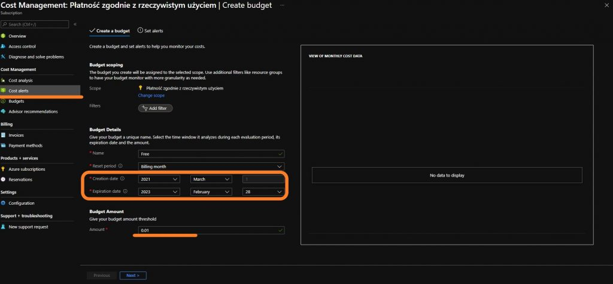
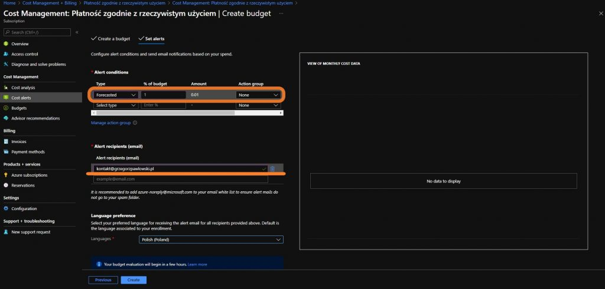
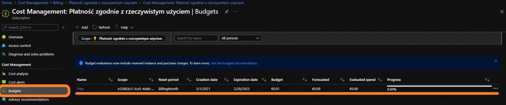

Jak monitorować wydatki na usługi w Azure i zmniejszyć ryzyko przekroczenia założonego budżetu? Szczególnie gdy korzystasz z Azure do niekomercyjnych projektów i najlepiej, żeby było całkowicie za darmo? Dobrze ustawiony alarm (Cost Alert) w **Cost Management** może pomóc, ale nie gwarantuje powiadomienia przed naliczeniem opłat.

Dane o kosztach są zwykle dostępne z opóźnieniem 8–24 godzin, budżety są oceniane co 24 godziny, a wysyłka powiadomienia również zajmuje czas. Prognoza nie musi być dostępna od razu. Zasoby nadal działają i naliczają koszty po przekroczeniu progu. Twardy limit wydatków, tam gdzie dany typ subskrypcji w ogóle go oferuje, jest osobnym mechanizmem; automatyczne wyłączanie zasobów także wymaga osobnej konfiguracji.

## Przykład: Wszystko za darmo

W konfiguracji przedstawionej na historycznych zrzutach nie dało się ustawić budżetu 0, więc użyłem progu 0,01 EUR. To próg powiadomienia, nie maksymalna opłata ani obietnica, że zapłacisz właśnie tyle.

W **Cost Management + Billing > Cost Management > Cost Alerts** dodaj nowy alert. Musisz ustawić:

- **Reset period** – okres rozliczeniowy, który może być miesięczny, kwartalny lub roczny. Dobierz go do sposobu kontroli kosztów; dłuższy okres sam w sobie nie zmniejsza faktury. Sprawdź też, jak dla danego zakresu oceniane są budżety kwartalne i roczne.
- **Creation date i Expiration Date** – tutaj spokojnie można ustawić ważność budżetu na kilka lat w przód – w razie potrzeby zawsze można go usunąć.
- **Budget Amount** – ustawiasz wysokość budżetu na dany okres rozliczeniowy. Na zrzutach użyłem 0,01 EUR; sprawdź aktualną walidację kwoty w swoim portalu i zakresie rozliczeń.

Po ustawieniu nazwy i budżetu przechodzisz do następnego kroku – **Set alerts**. Tu po pierwsze ustawiasz warunek (jeśli przewidywany koszt przekroczy 100% budżetu), a po drugie podajesz adres e-mail, na który ma przyjść powiadomienie, w razie gdyby Twój budżet miał być przekroczony.

Klikasz **Create** i gotowe.

Pod **Cost alerts** jest zakładka **Budgets**, gdzie możesz przejrzeć i edytować utworzone budżety.

## Jak ograniczyć koszty?

Wiemy już, jak skorzystać z budżetu w przypadku, gdy nie chcemy płacić nic. A co w przypadku, kiedy mamy założony budżet, ale okazuje się, że zasoby na Azure kosztują nas za dużo? Gdzie szukać oszczędności?

Wspomnę o kilku kwestiach, którym warto się przyjrzeć w tym kontekście:

- Czy zasoby, o których myślisz, że są darmowe, naprawdę takie są? Czy przy planowaniu budżetu szacujesz koszty dokładnie, używając np. [Azure Pricing Calculator](../azure-pricing-calculator/)?
- Czy wszystkie dane (za których przechowywanie płacisz od wielkości) są potrzebne? Czy nie masz starych, zapomnianych backupów, logów sprzed lat i innych resztek?
- Czy stosujesz skalowanie (planowane lub automatyczne, [pionowe](../automatyzacja-skalowania-azure/) lub poziome) tam, gdzie jest to możliwe?

Jeśli na którekolwiek z powyższych pytań odpowiedziałeś „Nie”, to zajrzyj do [pozostałych wpisów o Azure](../category/azure/) – mogą Ci w tych tematach pomóc!
