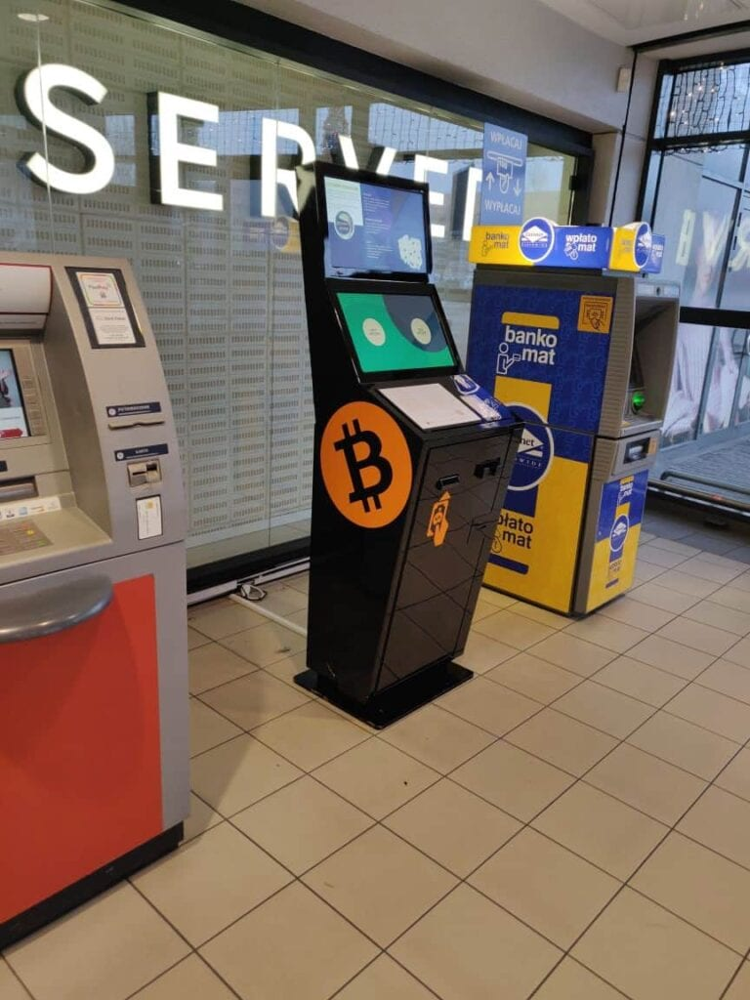
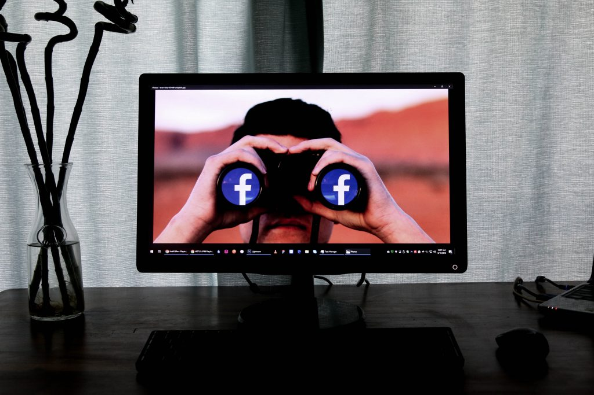

Wraz ze wzrostem popularności kryptowalut przybywa ludzi skupionych na szybkim zarobku, bez uwzględnienia bezpieczeństwa i prywatności. Nie są one automatycznymi cechami każdej kryptowaluty. W szczególności Bitcoin jest pseudonimowy: adresy nie muszą zawierać nazwiska, ale transakcje są publiczne i można je ze sobą łączyć.

Na szczęście, można wypracować pewien kompromis, co do którego wskazówki zebrałem poniżej.

Zaznaczę, że to, co jest tu napisane, ma zastosowanie do kwot od kilkuset do kilkunastu czy kilkudziesięciu tys. złotych. Inwestowanie większych kwot wiąże się z innego typu problemami. Niemniej jednak pewne ogólne prawdy obowiązują zawsze.

## Zakup kryptowalut

Usługodawcy mogą mieć obowiązki AML (przeciwdziałanie praniu pieniędzy), w tym identyfikację i weryfikację klienta, określaną jako KYC. Zakres zależy od przepisów i operatora. Warto oceniać ochronę powierzanych danych, ale nie zakładać, że transakcja gotówkowa zwalnia z identyfikacji.

KYC (ang. Know Your Customer) – regulacje wymagające odpowiedniego i pewnego zidentyfikowania klienta. Na giełdach zazwyczaj odbywa się przez wysłanie skanu dowodu osobistego oraz własnego zdjęcia w celu weryfikacji, czy rzeczywiście jest to nasz dowód.

Opis dawnych limitów Binance dotyczył zmian w 2021 r., a nie dzisiejszych warunków. Nie należy dobierać usługi na podstawie nieaktualnego limitu „bez KYC”; sprawdź obowiązującą procedurę, regulamin i dostępność w swoim kraju.

Sam SMS nie jest odpowiednikiem pełnej weryfikacji tożsamości. Kantor może wymagać dokumentów i dodatkowych informacji niezależnie od wybranej metody płatności.

Także kantor fizyczny i bitomat mogą wymagać identyfikacji oraz weryfikacji danych. FlyingAtom w swojej polityce AML wskazuje obowiązek weryfikacji niezależnie od kwoty, również poniżej 1000 EUR. Dawne twierdzenie o podaniu dowolnych danych i anonimowym bitomacie było błędne. Porównuj rzeczywisty kurs oraz wszystkie opłaty — nie ma jednej zawsze najtańszej metody.

Sam byłem zaskoczony, jakie mogą być różnice:

| **Rodzaj zakupu** | **Kurs (1 BTC)** | **Ostateczna ilość BTC** | **% powyżej ceny rynkowej** | **Różnica w PLN** | **Opłaty (wliczyłem w kurs)** |
| --- | --- | --- | --- | --- | --- |
| Bitomat | 195 288 zł | 0,0051207 | 4,53% | 45 zł | 5 zł |
| Giełda | 208 244 zł | 0,0048021 | 11,46% | 115 zł | 0,0005 BTC = 93 zł |

Archiwalny przykład zakupu za 1000 zł przy przyjętym kursie rynkowym 186 840 zł. W pierwotnym podpisie była data „27.08.2020”, niespójna z podanym poziomem kursu; nie mam źródła pozwalającego pewnie ustalić właściwą datę. Tabela nie jest aktualnym porównaniem FlyingAtom i BitBay. Kolumna „Kurs” uwzględnia tu koszty, więc jest efektywną ceną zakupu, a nie samym notowaniem giełdowym.

Bitomat w Krakowie. Źródło: [flyingatom.com](https://flyingatom.com/bitomat-krakow/).

### Co robić?

- Sprawdź wymogi identyfikacji, politykę danych i pełne koszty wybranego operatora. Nie podawaj fałszywych danych ani nie traktuj gotówki jako sposobu obejścia obowiązków.
- Udostępniaj dane tylko po sprawdzeniu autentyczności usługi. Osobny numer telefonu może ograniczyć łączenie kontaktów, ale nie zapewnia anonimowości transakcji i nie zastępuje KYC.
- Zachowuj potwierdzenia od początku. Dokumentacja będzie potrzebna niezależnie od metody zakupu.

## Przechowywanie kryptowalut

Są różne sposoby na przechowywanie krypto. Opisałem je bardziej szczegółowo we wpisie [Jak zacząć inwestować w Bitcoina?](../jak-zaczac-inwestowac-w-bitcoina/). Który sposób będzie najlepszy?

Nie ma jednego najlepszego portfela. Papierowy zapis pojedynczego klucza bywa trudny i ryzykowny w obsłudze; nie myl go z bezpieczną kopią seeda. Portfel sprzętowy może ograniczyć ekspozycję kluczy, ale nie ukrywa transakcji w blockchainie. Aplikacja towarzysząca i dostawcy infrastruktury również mogą przetwarzać dane — zakup urządzenia nie jest jedynym śladem. Zabezpiecz frazę odzyskiwania i zweryfikuj urządzenie zgodnie z dokumentacją.

*Ledger Nano S ([https://shop.ledger.com/products/ledger-nano-s](https://shop.ledger.com/products/ledger-nano-s))*

Najgorszy wybór (choć znów najwygodniejszy i najtańszy) to trzymanie krypto na giełdzie. Zdecydowanie odradzam nie tyle nawet ze względu na prywatność, co ze względu na bezpieczeństwo naszych środków – znów odsyłam po szczegóły do tekstu [Jak zacząć inwestować w Bitcoina?](../jak-zaczac-inwestowac-w-bitcoina/) oraz [9 błędów początkujących](../kryptowaluty-9-bledow-poczatkujacych/).

Istotna, choć nieoczywista rada – nie udostępniaj w internecie informacji o tym, gdzie, ile i jakie posiadasz kryptowaluty. Ściany mają uszy – szczególnie wall na Facebooku…

### Co zrobić?

- Rozumiej ryzyko przechowywania u operatora i samodzielnej opieki nad kluczami.
- Wybierz utrzymywany portfel oraz przygotuj i sprawdź bezpieczną kopię odzyskiwania.
- Jeśli kupujesz portfel sprzętowy, kupuj bezpośrednio u producenta.
- Zachowaj dla siebie informację o swoich inwestycjach. Internet i tak wie już o Tobie wystarczająco.

## Sprzedaż kryptowalut

Sytuacja ze sprzedażą jest podobna jak z zakupem. Z jedną drobną różnicą: jeśli ktoś wie, kiedy, ile i za jaką kwotę kupiłeś kryptowaluty, to wie tylko, że je masz. Jeśli przechowujesz je w bezpieczny sposób, to potencjalny złodziej musiałby podstępem lub groźbą przekonać Cię do zdradzenia mu klucza prywatnego. Żeby taka sytuacja miała miejsce, ktoś najpierw musiałby zdobyć Twoje dane (np. wskutek ataku hakerskiego lub wycieku z giełdy), a następnie dotrzeć do Ciebie i spróbować zdobyć klucz. Gorsza sytuacja to taka, gdy na Twoich kryptowalutach chce położyć rękę rząd.

Jednak jeśli ktoś ma informacje zarówno o zakupie, jak i sprzedaży, wie też o Twoim potencjalnym zysku. Wiedząc, że się wzbogaciłeś, może chcieć w sposób podstępny (złodziej) lub oficjalny (rząd) odebrać Ci całość lub część wypracowanego zysku. Tutaj pojawia się więcej możliwości zarówno dla złodzieja (kradzież gotówki, włamanie na konto, różne sposoby na wyłudzenie), jak i dla rządu (podatki).

Oczywiście nie namawiam do niepłacenia podatków. Zwracam tylko uwagę, że to my możemy być jedynymi osobami wiedzącymi o tym, że należy je zapłacić i w jakiej wysokości.

Ani giełda, ani bitomat nie gwarantują anonimowości. Sprzedaż za gotówkę również może być objęta weryfikacją i obowiązkami podatkowymi. Zgodnie z informacją MF koszty wykazuje się w PIT-38 także bez sprzedaży, a zapłata kryptowalutą za towary lub usługi może być odpłatnym zbyciem.

**Co zrobić?**

- Dobierz legalnie dostępną metodę, porównaj koszty i bezpieczeństwo oraz zachowaj dowody transakcji. Nie wybieraj bitomatu na podstawie obietnicy anonimowości.

## Podsumowanie

Nawet jeżeli niezbyt zależy Ci na anonimowości, bo myślisz, że nie jesteś przestępcą i nie masz nic do ukrycia, to zachęcam przynajmniej do przemyślenia powyższych wskazówek. Przekonanie, że skoro jesteś ok, to wielkie instytucje finansowe i rządy będą wobec Ciebie fair i będą dbały o Twoje dobro, jest… naiwne. Jeśli mówią, że chcą Twojego dobra, to czym prędzej schowaj je przed nimi 😉 Nie wspominając o pospolitych złodziejach.

Ograniczaj ujawnianie danych, zabezpieczaj urządzenia i kopie, ale nie traktuj tych kroków jako gwarancji anonimowości. Bitcoin pozostawia trwałą, publiczną historię; sprzętowy portfel ani gotówka jej nie usuwają.
