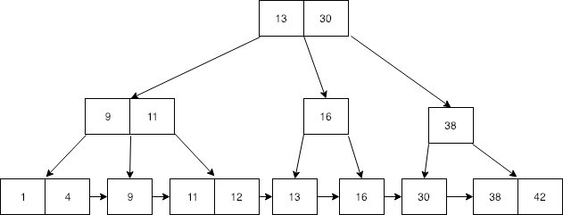
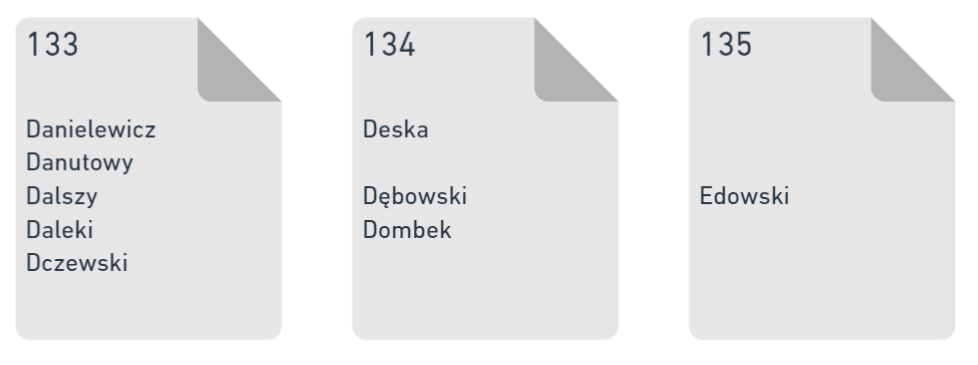
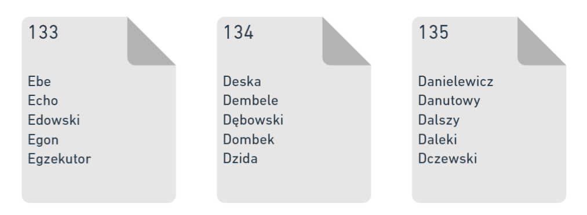

W ogólności, indeksy w SQL są bardzo ważne, a z punktu widzenia wydajności często kluczowe! Czy to znaczy, że zawsze warto je stosować i w sumie to nie mają wad? Bynajmniej. Nawet jeśli już stosować, to co i jak indeksować? Poniżej proste wyjaśnienie, z czym się je SQL Index.

## Indeks

Indeks jest jak książka telefoniczna (jeśli nie pamiętasz, co to jest, to jest to książka ze spisanymi numerami telefonów domowych, adresami i nazwiskiem).

Wyobraź sobie, że taka książka powstaje od zera. Książka najpierw jest pusta, potem dopisuje się kolejnych ludzi w miarę, jak powstają nowe domy, wprowadzają się mieszkańcy i podłączają telefon. Dane nie będą posortowane ani według nazwiska, ani według adresu.

Teraz w tej książce, która ma kilka tysięcy wpisów, musisz znaleźć numer telefonu Jerzego Dudka. Jedynym sposobem jest przeglądanie po kolei każdego wpisu, aż znajdziesz ten konkretny. Usprawnijmy to jakoś.

Po posortowaniu danych po nazwisku będzie już łatwiej, bo można oszacować, że będzie to gdzieś na początku, a jeśli akurat trafisz na jakieś nazwisko na F, to wiesz, że szukać trzeba na wcześniejszych, a nie dalszych stronach. Niemniej jednak nadal musisz znaleźć stronę, na której jest Jerzy Dudek, a później znaleźć konkretny wpis na tej stronie. Usprawnijmy to jeszcze bardziej!

Ponumerujmy strony. Teraz na jednej ze stron mamy nazwiska od De do Dz, więc Dudek zaczynający się na Du mieści się w tym przedziale. Musimy tylko wiedzieć, która to strona. Stwórzmy więc taki spis:

| **Nr strony** | **Od** | **Do** |
| --- | --- | --- |
| 133 | Da | Dc |
| <mark>134</mark> | <mark>De</mark> | <mark>Dz</mark> |
| 135 | Ea | Eg |

Teraz wystarczy w takim spisie znaleźć odpowiedni przedział i otworzyć stronę 134. **Ten spis to właśnie indeks!**

Podobnie jest z tabelą SQL. Jeśli mamy wiersze i każdy z nich ma ID (1, 2, 3…), to łatwiej znaleźć wiersz o ID 4356, jeśli mamy indeks, który powie nam, że na stronie 241 mamy ID od 240 do 250.

Jak pewnie zauważyłeś, żeby zastosować taki indeks, klucz indeksu (w tym przypadku ID, w poprzednim nazwisko) musi zostać posortowany.

## Podstawy teoretyczne

Jest kilka zagadnień, które są ważne dla zrozumienia istoty tego, o czym jest tutaj mowa. Jeśli nie chcesz tak bardzo zagłębiać się w temat, możesz pominąć ten akapit i ewentualnie wrócić do niego, jeśli będziesz potrzebować.

### Strona

Strona to podstawowa struktura przechowywania danych w SQL Serwerze. Strona ma 8kb wielkości, składa się z nagłówka, zawartości i offsetu. Dane na stronie nie są uporządkowane.

### Hobbit (HoBT) – Heap or B-Tree

Jest to sposób, w jaki przechowywane są dane – albo na stercie (heap) albo w B-drzewie (B-Tree).

### Sterta – Heap

Nazwa dobrze oddaje istotę rzeczy. Jest to sterta stron – nieuporządkowana, bez żadnych odwołań do innych stron. Składa się tylko ze stron z danymi i jeśli nie ma zdefiniowanego indeksu, to tak właśnie przechowywane są dane.

### B-Drzewo (B-Tree, Balanced Tree)

Ta forma przechowywania to ustrukturyzowany obiekt, który jest używany do przechowywania zindeksowanych danych. Składa się ze strony głównej (root page), o której można pomyśleć jak o korzeniu drzewa, z której wychodzą odwołania do stron kolejnego poziomu (stron pośrednich – intermediate pages), a z nich do kolejnych, jak w drzewie i w ten sposób dochodzimy do ostatniego poziomu (liści).



Źródło: [Database B-tree indexing in SQLite – DZone (kopia archiwalna)](https://web.archive.org/web/20220625071429/https://dzone.com/articles/database-btree-indexing-in-sqlite).

### Scan vs Seek

To dwa sposoby znajdowania wartości. Trzymając się analogii książki telefonicznej, załóżmy, że chcemy znaleźć numer osoby o imieniu Andrzej i nazwisku Nowak.

**Skan** polega na przejrzeniu każdej strony po kolei, aż znajdziemy Andrzeja Nowaka. Jeśli dane są nieuporządkowane i nie mamy indeksu, to nie mamy wyjścia i tak właśnie musimy szukać.

**Seek** to efektywna metoda, przy której korzystamy z indeksu. Mając książkę z nazwiskami i imionami uporządkowanymi alfabetycznie, możemy znaleźć Andrzeja Nowaka o wiele szybciej.

## Indeks złożony – Composite SQL Index

Indeks może być stworzony na bazie więcej niż jednej kolumny. Rozwińmy więc trochę nasz przykład z książką adresową i załóżmy, że mamy tam też kolumnę z wiekiem danej osoby. Chcielibyśmy wyszukać wszystkie osoby o nazwisku Nowak w wieku od 25 do 30 lat. O ile indeks na nazwisku nieco nam pomoże, to przy dużej ilości danych spowodowanych popularnością nazwiska, możemy dostać np. kilkanaście stron Nowaków. Jeżeli zindeksujemy wiek, to w tym momencie ułatwimy sobie wyszukiwanie. To jest właśnie idea composite index.

## Indeks filtrowany – Partial/Filtered SQL Index

Czasami tylko część wierszy z naszej tabeli jest używana na tyle często, żeby ich indeksowanie było potrzebne. Dobrym przykładem jest tabela z zamówieniami, z których część po pewnym czasie zmienia status na archiwalny i nie jest nigdy odczytywana przez aplikację. W tym przypadku dobrze sprawdzi się indeks filtrowany, gdzie zindeksujemy tylko zamówienia o konkretnym statusie.

| OrderId | LastUpdateDate | OrderStatus |
| --- | --- | --- |
| 1 | 2022-07-22 14:10:49.753 | InProgress |
| 2 | 2022-07-22 14:10:53.050 | InProgress |
| 3 | 2022-07-22 14:10:54.443 | InProgress |
| 4 | 2022-07-22 14:11:04.497 | Cancelled |
| 5 | 2022-07-22 14:11:05.597 | Cancelled |
| 6 | 2022-05-22 14:11:56.627 | Archived |
| 7 | 2022-04-22 14:12:02.760 | Archived |
| 8 | 2022-04-22 14:12:11.580 | Archived |
| 9 | 2022-04-22 14:12:04.817 | Archived |
| 10 | 2022-04-22 14:12:04.990 | Archived |
| 11 | 2022-04-22 14:12:06.513 | Archived |
| 12 | 2022-04-22 14:12:07.760 | Archived |
| 13 | 2022-03-22 14:12:09.433 | Archived |
| 14 | 2022-03-22 14:12:09.657 | Archived |
| 15 | 2022-03-22 14:12:10.200 | Archived |

A poniżej SQL do stworzenia indeksu, gdzie w prostym WHERE definiujemy zakres indeksu:

```
CREATE NONCLUSTERED INDEX
IX_LastUpdateDate
ON
Orders(LastUpdateDate)
WHERE OrderStatus IN ('InProgress', 'Cancelled');
```

## Indeks unikalny – Unique SQL Index

Tutaj sprawa jest bardzo prosta, bo unikalność to po prostu cecha, jaką dodajemy do indeksu. Np. w powyższym przykładzie moglibyśmy założyć indeks na jakiejś kolumnie identyfikującej, np. **OrderId**, dzięki czemu zapewniamy, że wartości w tej kolumnie są unikalne.

## Fragmentacja

W prostych słowach, fragmentacja to nieuporządkowanie zindeksowanych danych. Pamiętasz porównanie do książki telefonicznej na początku tekstu? Przypomnę jeszcze raz tabelę:

| **Nr strony** | **Od** | **Do** |
| --- | --- | --- |
| 133 | Da | Dc |
| 134 | De | Dz |
| 135 | Ea | Eg |

Na początku wszystko jest OK, a indeks stworzony jest w taki sposób, żeby na każdej stronie była mniej więcej równa liczba wierszy. Wyobraźmy to sobie tak:


Z czasem jednak dane w tabeli są modyfikowane, dodawane i usuwane, a więc zawartość tych stron będzie się zmieniać. Po czasie będzie to wyglądać na przykład tak:



Niezbyt uporządkowane, prawda? Ten rodzaj fragmentacji, gdzie nieuporządkowanie dotyczy zawartości stron – mają one bardzo zróżnicowany rozmiar, jest określany **fragmentacją wewnętrzną.**

Fragmentacja może być jeszcze inna, ale żeby ją opisać, zacznijmy od dwóch pojęć. **Logiczny porządek** – porządek, w jakim powinny znajdować się strony, wynikający z wartości, na której założony jest indeks. W naszym przypadku logicznym porządkiem jest porządek alfabetyczny – A następuje po B, a nie np. po F.

**Porządek alokacji** – fizyczny porządek, w jakim ułożone są strony w pamięci. W naszym przypadku jest on reprezentowany przez nr strony. Niezgodność tych porządków powoduje **fragmentację logiczną**, zwaną też fragmentacją zewnętrzną. Zobaczmy ilustrację:



Jak widać, porządek logiczny nie jest zachowany.  
  
Stopień fragmentacji można zmierzyć w procentach. Oto przykładowy kod SQL, który mierzy statystyki fragmentacji logicznej (w skrócie, odsetek stron w niepoprawnej kolejności):

```
SELECT S.name as 'Schema',
T.name as 'Table',
I.name as 'Index',
DDIPS.avg_fragmentation_in_percent,
DDIPS.page_count
FROM sys.dm_db_index_physical_stats (DB_ID(), NULL, NULL, NULL, NULL) AS DDIPS
INNER JOIN sys.tables T on T.object_id = DDIPS.object_id
INNER JOIN sys.schemas S on T.schema_id = S.schema_id
INNER JOIN sys.indexes I ON I.object_id = DDIPS.object_id
AND DDIPS.index_id = I.index_id
WHERE DDIPS.database_id = DB_ID()
and I.name is not null
AND DDIPS.avg_fragmentation_in_percent > 0
ORDER BY DDIPS.avg_fragmentation_in_percent desc
```

| **Schema** | **Table** | **Index** | **avg_fragmentation_in_percent** | **page_count** |
| --- | --- | --- | --- | --- |
| dbo | Orders | IX_LastUpdateDate | 99.5 | 400 |
| dbo | Users | IX_UserName | 43 | 5 |
| dbo | Products | IX_ProductId | 3 | 14 |

Przykładowe statystyki fragmentacji

## Odbudowa a reorganizacja

Można dane defragmentować na różne sposoby, przy czym w celu przywrócenia porządku w indeksach możemy:

- **Odbudować (REBUILD INDEX)** – polega na stworzeniu indeksów od nowa.
- **Zreorganizować (REORGANIZE INDEX)** – nie tworzy indeksów od nowa, a jedynie czyści puste miejsca na stronach.

Kiedy odbudować, a kiedy reorganizować? Nie ma jednej odpowiedzi, ale ogólnie im większa fragmentacja, tym więcej sensu ma odbudowa. Przykładowe, w miarę sensowne wartości to:

- 0 do 5% – niska fragmentacja, nie trzeba nic robić
- 5 do 30% – średnia fragmentacja, reorganizować
- 30 do 100% – wysoka fragmentacja, odbudować.

W poniższej tabelce kilka istotnych różnic między odbudową a reorganizacją:

| **REBUILD** | **REORGANIZE** |
| --- | --- |
| Można wykonać wielowątkowo | Wykonywana zawsze w jednym wątku |
| Aktualizacja statystyk | Brak aktualizacji |
| Szybka przy wysokiej fragmentacji | Wolna przy wysokiej fragmentacji |
| Wolna przy niskiej fragmentacji | Szybka przy niskiej fragmentacji |
| Może być online<br>(nie w każdej wersji SQL serwera) lub offline | Zawsze online |
| Albo przebuduje całkowicie albo wcale | Można przerwać bez utraty postępu |

## Podsumowanie

Co moim zdaniem warto zapamiętać:

- Indeksy przyspieszają odczyt, jeśli są odpowiednio stworzone
- Coś za coś – istnienie indeksów powoduje konieczność ich utrzymania – trzeba dbać o defragmentację. Używaj wtedy, kiedy potrzebujesz, i tam, gdzie potrzebujesz.
- Dobierz sposób defragmentacji do warunków, wymagań i stopnia fragmentacji

Polecam obszerny tekst Chada Boyda, który podlinkowałem w referencjach – jest tam dużo więcej informacji w temacie, który tutaj podsumowałem i streściłem.

## Referencje:

- [SQL Server Index Fragmentation In-depth](https://blog.devart.com/sql-server-index-fragmentation-in-depth.html)
- [Chad Boyd – SQL Server Fragmentation Storage basics and Access Methods (kopia archiwalna)](https://web.archive.org/web/20220706070713/https://www.mssqltips.com/sqlservertip/2261/sql-server-fragmentation-storage-basics-and-access-methods-part-1-of-9/)
- [Jignesh Raiyani – How to identify and resolve SQL Server Index Fragmentation](https://www.sqlshack.com/how-to-identify-and-resolve-sql-server-index-fragmentation/)
