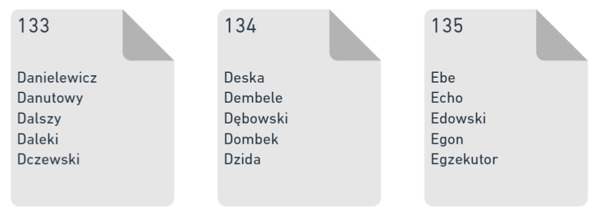

W ogólności, indeksy w SQL są bardzo ważne, a z punktu widzenia wydajności często kluczowe! Czy to znaczy, że zawsze warto je stosować i w sumie to nie mają wad? Bynajmniej. Nawet jeśli już stosować, to co i jak indeksować? Poniżej proste wyjaśnienie, z czym się je SQL Index.

## Indeks

Indeks jest jak książka telefoniczna (jeśli nie pamiętasz, co to jest, to jest to książka ze spisanymi numerami telefonów domowych, adresami i nazwiskiem).

Wyobraź sobie, że taka książka powstaje od zera. Książka najpierw jest pusta, potem dopisuje się kolejnych ludzi w miarę, jak powstają nowe domy, wprowadzają się mieszkańcy i podłączają telefon. Dane nie będą posortowane ani według nazwiska, ani według adresu.

Teraz w tej książce, która ma kilka tysięcy wpisów, musisz znaleźć numer telefonu Jerzego Dudka. Jedynym sposobem jest przeglądanie po kolei każdego wpisu, aż znajdziesz ten konkretny. Usprawnijmy to jakoś.

Po posortowaniu danych po nazwisku będzie już łatwiej, bo można oszacować, że będzie to gdzieś na początku, a jeśli akurat trafisz na jakieś nazwisko na F, to wiesz, że szukać trzeba na wcześniejszych, a nie dalszych stronach. Niemniej jednak nadal musisz znaleźć stronę, na której jest Jerzy Dudek, a później znaleźć konkretny wpis na tej stronie. Usprawnijmy to jeszcze bardziej!

Ponumerujmy strony. Teraz na jednej ze stron mamy nazwiska od De do Dz, więc Dudek zaczynający się na Du mieści się w tym przedziale. Musimy tylko wiedzieć, która to strona. Stwórzmy więc taki spis:

| **Nr strony** | **Od** | **Do** |
| --- | --- | --- |
| 133 | Da | Dc |
| <mark>134</mark> | <mark>De</mark> | <mark>Dz</mark> |
| 135 | Ea | Eg |

Teraz wystarczy w takim spisie znaleźć odpowiedni przedział i otworzyć stronę 134. **Ten spis to właśnie indeks!**

Podobnie jest z tabelą SQL. Jeśli mamy wiersze i każdy z nich ma ID (1, 2, 3…), to łatwiej znaleźć wiersz o ID 4356, jeśli indeks wskaże stronę zawierającą zakres np. od 4300 do 4399. To ilustracja nawigacji po kluczu, nie sposób wyliczania numeru fizycznej strony z wartości ID.

Jak pewnie zauważyłeś, żeby zastosować taki indeks, klucz indeksu (w tym przypadku ID, w poprzednim nazwisko) musi zostać posortowany.

## Podstawy teoretyczne

Jest kilka zagadnień, które są ważne dla zrozumienia istoty tego, o czym jest tutaj mowa. Jeśli nie chcesz tak bardzo zagłębiać się w temat, możesz pominąć ten akapit i ewentualnie wrócić do niego, jeśli będziesz potrzebować.

### Strona

Strona w SQL Server ma 8 KiB (8192 bajty), w tym 96-bajtowy nagłówek, obszar danych i tablicę offsetów wierszy. Fizyczne położenie rekordów nie musi odpowiadać kolejności kluczy. Na stronie indeksu klastrowanego tablica slotów pozwala zachować logiczną kolejność wierszy — stwierdzenie, że na stronie „nie ma żadnego porządku”, byłoby zbyt dużym uproszczeniem.

### Hobbit (HoBT) – Heap or B-Tree

Jest to sposób, w jaki przechowywane są dane – albo na stercie (heap) albo w B-drzewie (B-Tree).

### Sterta – Heap

Sterta (heap) to tabela bez indeksu klastrowanego, bez porządku wierszy wynikającego z klucza takiego indeksu. **Może mieć indeksy nieklastrowane.** Nie jest też dosłownie zbiorem stron bez żadnych struktur zarządzania — SQL Server używa m.in. map alokacji, a przeniesione wiersze mogą mieć odwołania przekazujące.

### B-drzewo (B-tree)

Indeksy rowstore w SQL Server mają strukturę B+ tree, w dokumentacji często nazywaną ogólnie B-tree. Od korzenia przez ewentualne poziomy pośrednie dochodzimy do liści. W małym indeksie jedna strona może być jednocześnie korzeniem i liściem. W indeksie klastrowanym liście zawierają dane tabeli; nieklastrowany ma własne wpisy i lokalizatory wierszy.


Źródło: [Database B-tree indexing in SQLite – DZone (kopia archiwalna)](https://web.archive.org/web/20220625071429/https://dzone.com/articles/database-btree-indexing-in-sqlite).

### Scan vs Seek

To dwa sposoby znajdowania wartości. Trzymając się analogii książki telefonicznej, załóżmy, że chcemy znaleźć numer osoby o imieniu Andrzej i nazwisku Nowak.

**Scan** przegląda wiersze tabeli lub indeksu i sprawdza warunek. Nie musi skończyć się po pierwszym trafieniu — zapytanie może potrzebować wszystkich pasujących rekordów. Może być dobrym planem, jeśli trzeba odczytać znaczną część danych.

**Seek** wykorzystuje klucz indeksu do przejścia do określonej wartości lub zakresu. Często pomaga przy selektywnym warunku, ale sam napis „seek” w planie nie gwarantuje szybszego zapytania — liczy się liczba odczytów i dalsza praca, np. pobieranie brakujących kolumn.

## Indeks złożony – Composite SQL Index

Indeks złożony ma klucz z więcej niż jednej kolumny. Rozwińmy przykład książki adresowej: chcemy znaleźć Nowaków w wieku od 25 do 30 lat. Indeks o kluczu `(Nazwisko, Wiek)` porządkuje dane najpierw po nazwisku, a w obrębie nazwiska po wieku. To co innego niż dwa osobne indeksy na nazwisku i wieku. Kolejność kolumn ma znaczenie; indeks `(Wiek, Nazwisko)` może inaczej obsługiwać ten sam zestaw warunków. O wyborze planu decyduje optymalizator na podstawie m.in. selektywności i statystyk.

## Indeks filtrowany – Partial/Filtered SQL Index

Czasami tylko część wierszy z naszej tabeli jest używana na tyle często, żeby ich indeksowanie było potrzebne. Dobrym przykładem jest tabela z zamówieniami, z których część po pewnym czasie zmienia status na archiwalny i nie jest nigdy odczytywana przez aplikację. W tym przypadku dobrze sprawdzi się indeks filtrowany, gdzie zindeksujemy tylko zamówienia o konkretnym statusie.

| OrderId | LastUpdateDate | OrderStatus |
| --- | --- | --- |
| 1 | 2022-07-22 14:10:49.753 | InProgress |
| 2 | 2022-07-22 14:10:53.050 | InProgress |
| 3 | 2022-07-22 14:10:54.443 | InProgress |
| 4 | 2022-07-22 14:11:04.497 | Cancelled |
| 5 | 2022-07-22 14:11:05.597 | Cancelled |
| 6 | 2022-05-22 14:11:56.627 | Archived |
| 7 | 2022-04-22 14:12:02.760 | Archived |
| 8 | 2022-04-22 14:12:11.580 | Archived |
| 9 | 2022-04-22 14:12:04.817 | Archived |
| 10 | 2022-04-22 14:12:04.990 | Archived |
| 11 | 2022-04-22 14:12:06.513 | Archived |
| 12 | 2022-04-22 14:12:07.760 | Archived |
| 13 | 2022-03-22 14:12:09.433 | Archived |
| 14 | 2022-03-22 14:12:09.657 | Archived |
| 15 | 2022-03-22 14:12:10.200 | Archived |

A poniżej SQL do stworzenia indeksu, gdzie w prostym WHERE definiujemy zakres indeksu:

```
CREATE NONCLUSTERED INDEX
IX_LastUpdateDate
ON
Orders(LastUpdateDate)
WHERE OrderStatus IN ('InProgress', 'Cancelled');
```

## Indeks unikalny – Unique SQL Index

Tutaj sprawa jest bardzo prosta, bo unikalność to po prostu cecha, jaką dodajemy do indeksu. Np. w powyższym przykładzie moglibyśmy założyć indeks na jakiejś kolumnie identyfikującej, np. **OrderId**, dzięki czemu zapewniamy, że wartości w tej kolumnie są unikalne.

## Fragmentacja

W prostych słowach, fragmentacja to nieuporządkowanie zindeksowanych danych. Pamiętasz porównanie do książki telefonicznej na początku tekstu? Przypomnę jeszcze raz tabelę:

| **Nr strony** | **Od** | **Do** |
| --- | --- | --- |
| 133 | Da | Dc |
| 134 | De | Dz |
| 135 | Ea | Eg |

Na początku wszystko jest OK, a indeks stworzony jest w taki sposób, żeby na każdej stronie była mniej więcej równa liczba wierszy. Wyobraźmy to sobie tak:



Z czasem jednak dane w tabeli są modyfikowane, dodawane i usuwane, a więc zawartość tych stron będzie się zmieniać. Po czasie będzie to wyglądać na przykład tak:


Niezbyt uporządkowane, prawda? Nie zmienia się jednak rozmiar stron — nadal mają po 8 KiB. Zmienia się stopień ich wypełnienia: niska **gęstość stron**, potocznie wiązana z fragmentacją wewnętrzną, oznacza więcej wolnego miejsca i potencjalnie więcej stron do odczytania.

Fragmentacja może być jeszcze inna, ale żeby ją opisać, zacznijmy od dwóch pojęć. **Logiczny porządek** wynika z kolejności kluczy indeksu. W naszym przykładzie jest to porządek alfabetyczny: B następuje po A, a nie np. po F.

**Porządek alokacji** – fizyczny porządek, w jakim ułożone są strony w pamięci. W naszym przypadku jest on reprezentowany przez nr strony. Niezgodność tych porządków powoduje **fragmentację logiczną**, zwaną też fragmentacją zewnętrzną. Zobaczmy ilustrację:


Jak widać, kolejność stron w alokacji nie odpowiada kolejności kluczy. Indeks nadal potrafi przejść po danych logicznie; fragmentacja nie oznacza, że wyniki bez `ORDER BY` otrzymają gwarantowany porządek.
  
Stopień fragmentacji można zmierzyć w procentach. Oto przykładowy kod SQL, który mierzy statystyki fragmentacji logicznej (w skrócie, odsetek stron w niepoprawnej kolejności):

```
SELECT S.name as 'Schema',
T.name as 'Table',
I.name as 'Index',
DDIPS.avg_fragmentation_in_percent,
DDIPS.page_count
FROM sys.dm_db_index_physical_stats (DB_ID(), NULL, NULL, NULL, NULL) AS DDIPS
INNER JOIN sys.tables T on T.object_id = DDIPS.object_id
INNER JOIN sys.schemas S on T.schema_id = S.schema_id
INNER JOIN sys.indexes I ON I.object_id = DDIPS.object_id
AND DDIPS.index_id = I.index_id
WHERE DDIPS.database_id = DB_ID()
and I.name is not null
AND DDIPS.avg_fragmentation_in_percent > 0
ORDER BY DDIPS.avg_fragmentation_in_percent desc
```

| **Schema** | **Table** | **Index** | **avg_fragmentation_in_percent** | **page_count** |
| --- | --- | --- | --- | --- |
| dbo | Orders | IX_LastUpdateDate | 99.5 | 400 |
| dbo | Users | IX_UserName | 43 | 5 |
| dbo | Products | IX_ProductId | 3 | 14 |

Przykładowe statystyki fragmentacji

## Odbudowa a reorganizacja

Można dane defragmentować na różne sposoby, przy czym w celu przywrócenia porządku w indeksach możemy:

- **Odbudować (`ALTER INDEX ... REBUILD`)** – tworzy strukturę indeksu od nowa.
- **Zreorganizować (`ALTER INDEX ... REORGANIZE`)** – dla indeksu rowstore porządkuje strony poziomu liści i kompaktuje je zgodnie z ustawieniami wypełnienia. Nie sprowadza się to do „czyszczenia pustych miejsc”.

Kiedy odbudować, a kiedy reorganizować? Nie ma jednej odpowiedzi. Często powtarzane historyczne progi to:

- 0 do 5% – niska fragmentacja, nie trzeba nic robić
- 5 do 30% – średnia fragmentacja, reorganizować
- 30 do 100% – wysoka fragmentacja, odbudować.

Nie traktuj ich jako gotowej polityki utrzymania. Duża fragmentacja małego indeksu może być nieistotna, a przebudowa może kosztować więcej niż potencjalna poprawa. Sprawdź rozmiar, gęstość stron, charakter odczytów, statystyki, dostępne okno utrzymaniowe i rzeczywisty wpływ na wydajność. Nie wykonuj automatycznie kosztownych przebudów tylko dlatego, że procent przekroczył próg.

W poniższej tabelce kilka istotnych różnic między odbudową a reorganizacją:

| **REBUILD** | **REORGANIZE** |
| --- | --- |
| Można wykonać wielowątkowo | Wykonywana zawsze w jednym wątku |
| Aktualizuje statystyki przebudowywanego indeksu; nie wszystkie statystyki tabeli | Nie aktualizuje statystyk |
| Zwykle wymaga więcej zasobów i wolnego miejsca | Zwykle mniej zasobożerna dla rowstore |
| Może być online albo offline, zależnie od wersji, edycji i typu indeksu | Dla rowstore operacja online, ale nie „bez żadnych blokad” |
| W obsługiwanych konfiguracjach może być RESUMABLE | Można przerwać z zachowaniem wykonanej pracy |

## Podsumowanie

Co moim zdaniem warto zapamiętać:

- Indeksy przyspieszają odczyt, jeśli są odpowiednio stworzone
- Coś za coś: indeks zajmuje miejsce i zwiększa pracę przy INSERT/UPDATE/DELETE. Dobieraj go do zapytań, zamiast indeksować każdą kolumnę. Utrzymanie nie oznacza obowiązkowej cyklicznej defragmentacji wszystkiego.
- Dobierz sposób defragmentacji do warunków, wymagań i stopnia fragmentacji

Polecam obszerny tekst Chada Boyda, który podlinkowałem w referencjach – jest tam dużo więcej informacji w temacie, który tutaj podsumowałem i streściłem.

## Referencje:

- [SQL Server Index Fragmentation In-depth](https://blog.devart.com/sql-server-index-fragmentation-in-depth.html)
- [Chad Boyd – SQL Server Fragmentation Storage basics and Access Methods (kopia archiwalna)](https://web.archive.org/web/20220706070713/https://www.mssqltips.com/sqlservertip/2261/sql-server-fragmentation-storage-basics-and-access-methods-part-1-of-9/)
- [Jignesh Raiyani – How to identify and resolve SQL Server Index Fragmentation](https://www.sqlshack.com/how-to-identify-and-resolve-sql-server-index-fragmentation/)
