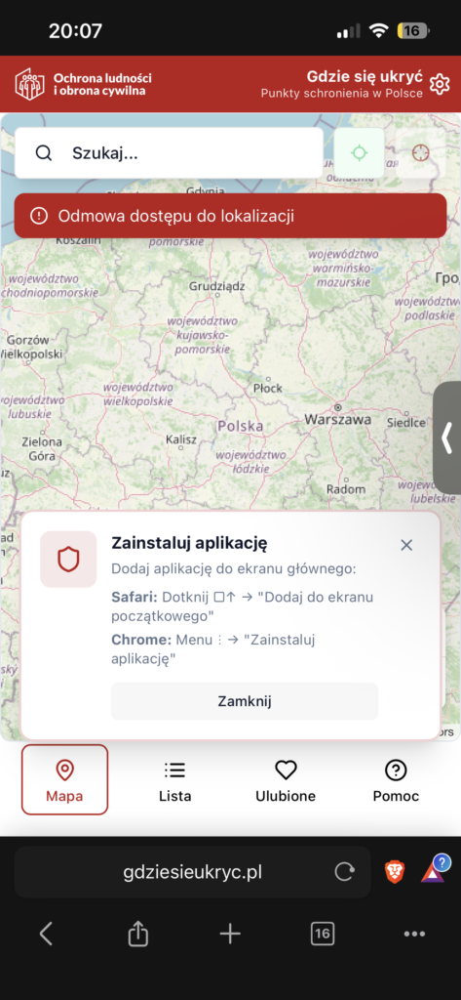
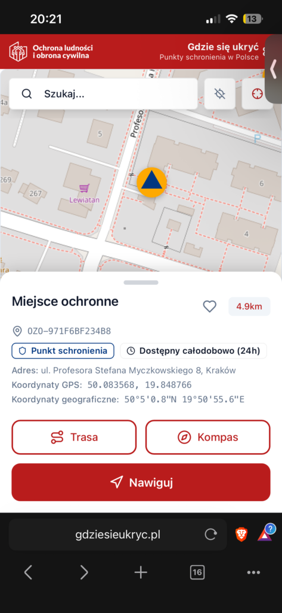
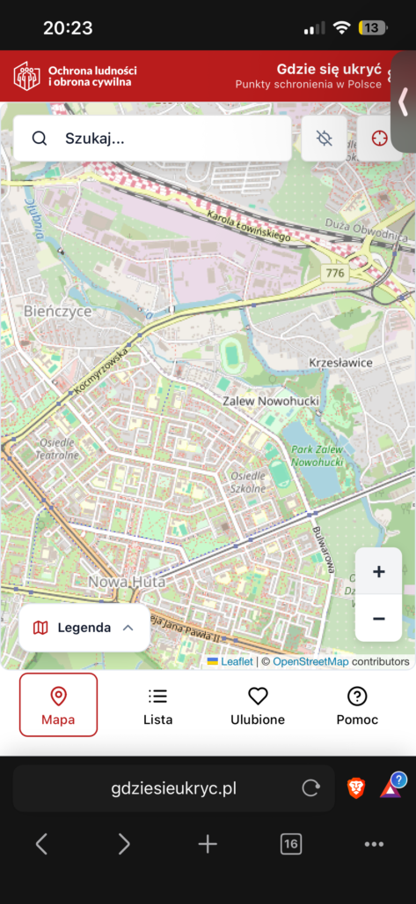
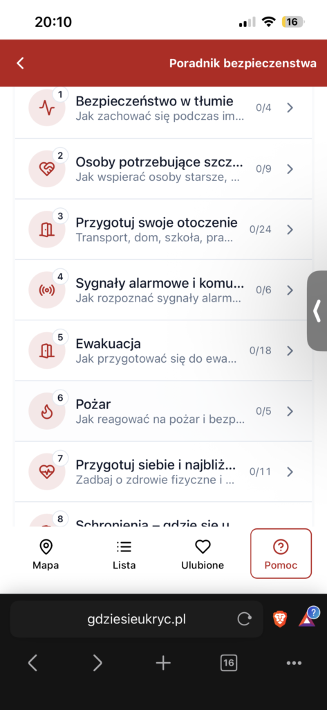
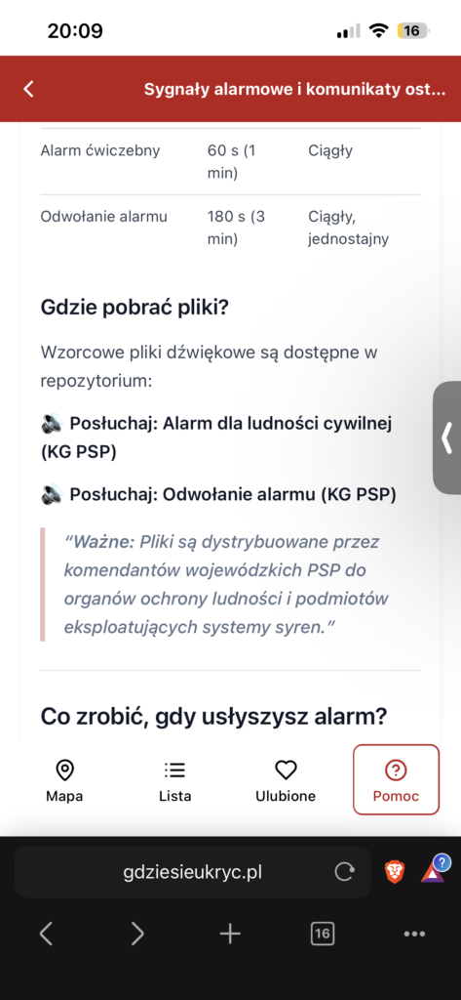
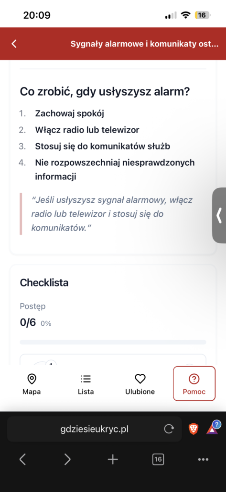
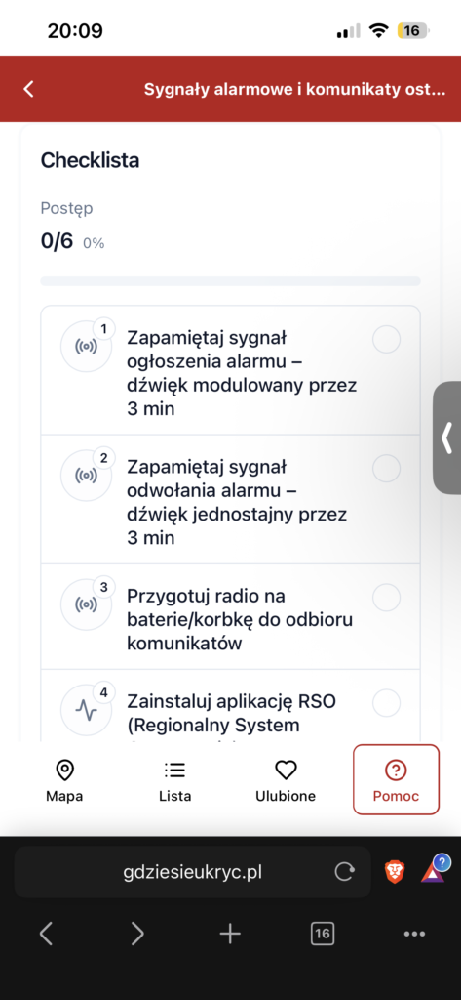

Na pierwszy rzut oka wszystko się zgadza. Nazwa: **Gdzie się ukryć**. Opis: schrony, miejsca ochronne, mapa. Czerwony pasek, poważna tematyka, bezpieczeństwo. I dokładnie z takim nastawieniem wchodzisz na stronę: *OK, pokażcie mi, gdzie w razie czego mam iść*. Tylko że po chwili okazuje się, że **najciekawsze rzeczy w tej aplikacji wcale nie są na mapie**… ale o tym za chwilę.

## Strona, aplikacja, PWA – i to akurat jest zrobione dobrze

Zacznijmy od plusów. Technicznie to jest zrobione sensownie.

To nie jest natywna aplikacja, tylko strona, którą można dodać do ekranu głównego telefonu – klasyczne PWA (czy jak ktoś woli: SPA + Web App Manifest).

Działa w przeglądarce, działa na telefonie, działa offline.

Jest nawet czytelna instrukcja „Zainstaluj aplikację” – i to jest jeden z tych momentów, gdzie ktoś faktycznie pomyślał o użytkowniku (szczególnie tym mniej biegłym technicznie), a nie tylko o checkboxach w projekcie.

Tak, na górze wyskakuje komunikat o odmowie dostępu do lokalizacji.

## Mapa schronów – OK, ale bez kontekstu

Mapa jest. Punkty są. Można kliknąć, zobaczyć adres, współrzędne, odległość, wyznaczyć trasę. I… w zasadzie tyle. Problem polega na tym, że **nie wiesz, czym to miejsce faktycznie jest**. Czy to:

- piwnica bloku?
- garaż podziemny?
- dawny schron z lat 70.?
- budynek użyteczności publicznej?

Nie ma zdjęć, nie ma opisu wejścia, nie ma informacji, czy to jest dostępne realnie, czy tylko „na papierze”. Choć według przepisów powinno być. A może jest to miejsce na jakieś opinie użytkowników (podobnie jak na google)? W sytuacji kryzysowej to są rzeczy absolutnie kluczowe, aby szybko się tam dostać. Druga sprawa: **zasięg**. Mapa pokazuje obiekty w promieniu kilku kilometrów od aktualnej lokalizacji. I to jest fajne… dopóki nie potrzebujesz sprawdzić czegoś gdzie indziej.

Wyobraź sobie prosty scenariusz:

> Dzwoni do Ciebie babcia.  
> Mieszka w Nowej Hucie, a Ty choćby w Skawinie.  
> Pyta: „gdzie ja mam iść?”
>
>
>
>
>
> I nagle okazuje się, że szybkie przesunięcie mapy i sprawdzenie schronów „obok” wcale nie jest takie oczywiste. Da się, ale to nie jest intuicyjne.

## I teraz najważniejsze: poradniki

A teraz przechodzimy do rzeczy, która kompletnie zmienia odbiór tej aplikacji. Bo **najlepszą częścią „Gdzie się ukryć” wcale nie jest mapa**. Najlepszą częścią są **poradniki**. I one… są schowane w zakładce „Pomoc”. To jest trochę tak, jakbyś wszedł do sklepu po młotek, a w kącie znalazł dobrze wyposażoną bibliotekę o budownictwie, tylko że nikt ci o niej nie powiedział. Są tam:

- sygnały alarmowe,
- ewakuacja,
- zagrożenia terrorystyczne,
- pożar,
- bezpieczeństwo w tłumie,
- przygotowanie domu,
- checklisty.

I to nie są lania wody.  
To jest konkret, napisany prostym językiem, z logiczną strukturą. Choć można mieć zastrzeżenia merytoryczne, to jednak dla przeciętnego obywatela już i tak ogromy krok na przód. Gdybym miał coś zmienić w całej aplikacji „na już”, to **wyciągnąłbym poradniki na pierwszy plan**.  
Bo edukacyjnie to jest dużo cenniejsze niż sama mapa. No i sama aplikacja mogłaby nazywać się inaczej, na przykład Ostoja, Tarcza, Bastion, Czuwaj…

## Sygnały alarmowe – i bardzo poważny zgrzyt

Jest sekcja o sygnałach alarmowych. Opisane, czym się różni alarm od odwołania alarmu. I nagle widzisz coś takiego:  **Posłuchaj: Alarm dla ludności cywilnej**. Klikasz. I… nic się nie dzieje. I to jest naprawdę duży problem. Bo jeśli mówimy o **bezpieczeństwie**, to możliwość *odsłuchania* sygnału jest ważniejsza niż jego opis tekstowy. Nie chodzi o estetykę. Chodzi o „pamięć mięśniową”, o rozpoznanie dźwięku w stresie. Bez pliku audio ta sekcja jest po prostu niekompletna.

## „Włącz radio lub telewizor” – czyli instrukcja z innej epoki

W poradniku „Co zrobić, gdy usłyszysz alarm?” pojawia się punkt: **Włącz radio lub telewizor**. I tu serio musiałem się zatrzymać. Bo (i pewnie nie ja jeden):

- nie mam radia (no dobra, mam nawet dwa na sytuacje awaryjne, ale na co dzień ich przy sobie nie noszę,
- nie mam telewizora,
- alarm mogę usłyszeć poza domem.

Za to **prawie każdy ma telefon**. Powiadomienia RCB, aplikacja RSO, komunikaty w mObywatelu – to powinno być pierwsze, a nie ostatnie źródło informacji. To nie jest drobna uwaga stylistyczna. To jest realna luka między instrukcją a rzeczywistością.

## Checklista – bardzo dobry pomysł

Za to checklisty to jest strzał w dziesiątkę. Nie tylko „checklista sprzętu”, tylko **checklista wiedzy i przygotowania**. Masz pasek postępu, masz poczucie, że coś ogarniasz, masz lekką grywalizację, ale bez infantylności. I to działa dokładnie tak, jak powinno: uczy, porządkuje i nie przytłacza.

## „Walcz” w zagrożeniach terrorystycznych – i znowu pół kroku za daleko

Sekcja „Uciekaj – Ukryj się – Walcz” jest znana i sensowna. Ale kiedy dochodzimy do „Walcz”, pojawia się lista typu:

- krzesło,
- parasol,
- butelka.

I mam z tym problem. Bo to ustawia człowieka **w pozycji nigdy nie przygotowanej ofiary**. A może dodać:

- gaz pieprzowego,
- nóż,
- zachęty do przygotowania się *wcześniej* , a nie improwizowania w ostatniej chwili?

a do tego przypominajkę „Art. 25 § 1. *Nie popełnia przestępstwa, kto w obronie koniecznej odpiera bezpośredni, bezprawny zamach na jakiekolwiek dobro chronione prawem.*„, więc nie wahaj się zabić terrorysty.

To jest trudny temat, jasne. Ale unikanie go w imię „bezpiecznego przekazu” też jest decyzją – i moim zdaniem nie najlepszą. Nie zrozumcie mnie źle. Nie chodzi mi o to, żeby zachęcać każdego do zgrywania kozaka, który rzuci się z nożem na masowego zabójcę z karabinem. Chodzi o to, żeby zachęcać do wcześniejszego przygotowania się na taką sytuację.

Dla zainteresowanych tym, z jakimi naprawdę będziemy się mierzyć zagrożeniami polecam poniższy film:  
[https://www.youtube.com/embed/Cj0bEBrpVkM?si=43AGtBz-72mIavDX](https://www.youtube.com/embed/Cj0bEBrpVkM?si=43AGtBz-72mIavDX)

## API – potencjał, który aż się prosi o wykorzystanie

Na koniec coś, co zauważą głównie techniczni. Strona korzysta z **własnego API**. Otwartego. I to jest super. Tylko… nigdzie nie ma dokumentacji. A szkoda, bo:

- można by zrobić alternatywne wizualizacje,
- integracje,
- aplikacje lokalne.

Na prawdę jest wielu wolontariuszy, którzy mając narzędzia mogą zrobić świetne rzeczy.

## Podsumowanie

„Gdzie się ukryć” to nie jest idealna aplikacja. Ale to jest **ważna aplikacja**. Ma braki, ma miejsca do poprawy, czasem rozmija się z realiami. Ale ma też coś, czego bardzo brakuje w podobnych projektach: **sensowną edukację**. Pomimo swoich mankamentów, to duży krok w stosunku do tego, czym jako obywatele dysponowaliśmy dwa czy trzy lata temu. Czyli w stosunku do czegoś… czego prawie nie było.

Jeśli autorzy:

- dopracują poradniki,
- dodadzą multimedia,
- poprawią realizm instrukcji,
- i otworzą API z dokumentacją,

to z tej strony może wyrosnąć coś dużo większego niż mapa schronów. A to, w obecnych czasach, naprawdę ma znaczenie.

Sprawdźcie – warto: [gdziesieukryc.pl](https://gdziesieukryc.pl/)
