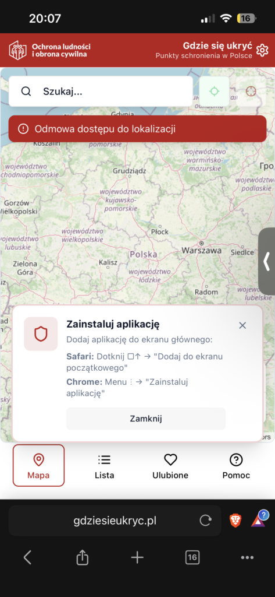
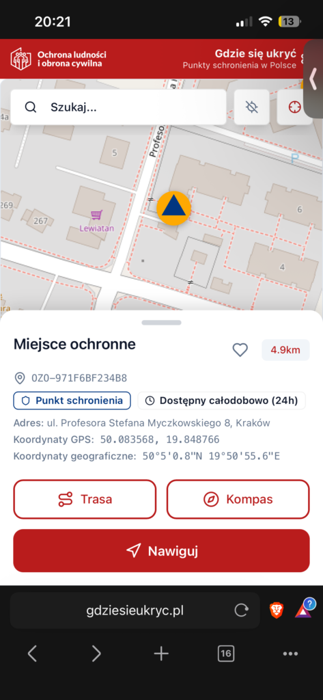
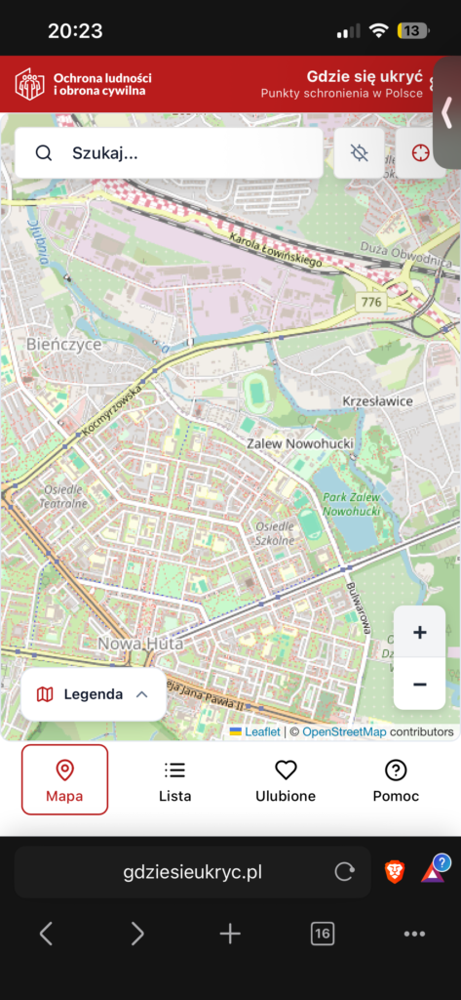
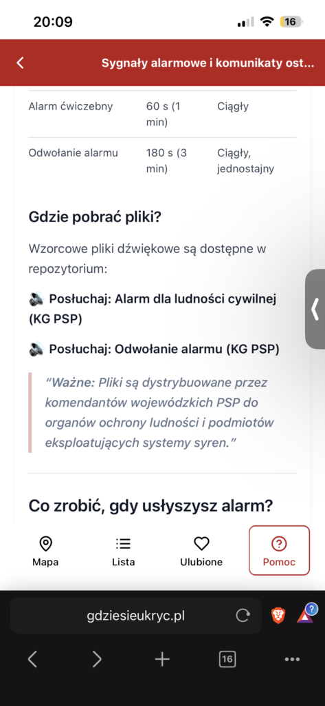
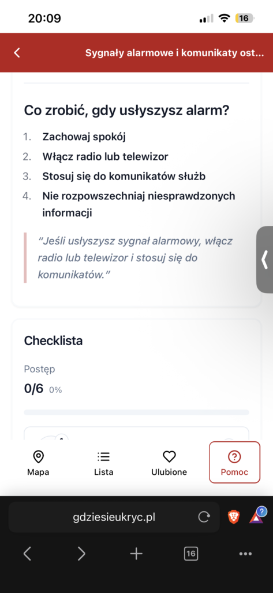
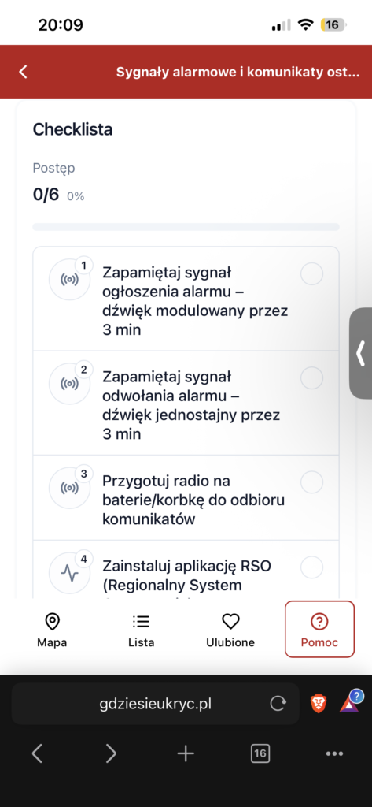

Na pierwszy rzut oka wszystko się zgadza. Nazwa: **Gdzie się ukryć**. Opis: schrony, miejsca ochronne, mapa. Czerwony pasek, poważna tematyka, bezpieczeństwo. I dokładnie z takim nastawieniem wchodzisz na stronę: *OK, pokażcie mi, gdzie w razie czego mam iść*. Tylko że po chwili okazuje się, że **najciekawsze rzeczy w tej aplikacji wcale nie są na mapie**… ale o tym za chwilę.

## Strona, aplikacja, PWA – i to akurat jest zrobione dobrze

Zacznijmy od plusów. Technicznie to jest zrobione sensownie.

W czasie testu była to aplikacja webowa z instrukcją dodania do ekranu głównego. PWA nie jest po prostu synonimem „SPA + manifest”; może być też wielostronicowe. Instalowalność i praca offline to odrębne właściwości.

Działała w przeglądarce na telefonie. Nie mam tu udokumentowanego testu zakresu działania bez sieci, więc wycofuję wcześniejsze bezwarunkowe „działa offline”. Mapy, kafelki, lokalizacja, poradniki i aktualizacja danych wymagają osobnego sprawdzenia, np. po wcześniejszym pobraniu i ponownym uruchomieniu w trybie samolotowym. Sam manifest nie zapewnia cache; zwykle odpowiada za niego service worker i konkretna strategia przechowywania danych.

Jest nawet czytelna instrukcja „Zainstaluj aplikację” – i to jest jeden z tych momentów, gdzie ktoś faktycznie pomyślał o użytkowniku (szczególnie tym mniej biegłym technicznie), a nie tylko o checkboxach w projekcie.

Tak, na górze wyskakuje komunikat o odmowie dostępu do lokalizacji.

Kliknij zrzut ekranu, aby otworzyć go w pełnej rozdzielczości.

## Mapa schronów – OK, ale bez kontekstu

Mapa jest. Punkty są. Można kliknąć, zobaczyć adres, współrzędne, odległość, wyznaczyć trasę. I… w zasadzie tyle. Problem polega na tym, że **nie wiesz, czym to miejsce faktycznie jest**. Czy to:

- piwnica bloku?
- garaż podziemny?
- dawny schron z lat 70.?
- budynek użyteczności publicznej?

W oglądanym widoku brakowało mi zdjęć, opisu wejścia i potwierdzenia realnej dostępności. Sam punkt na mapie nie dowodzi, że obiekt jest otwarty ani że ma parametry schronu — nie każde miejsce doraźnego ukrycia jest schronem. Nie zweryfikowałem podstawy dawnego zdania, że „według przepisów powinno być” dostępne, więc nie traktuj go jako ustalenia prawnego. Warto sprawdzić lokalne informacje i wejście wcześniej, a podczas zagrożenia stosować się do poleceń służb. Druga sprawa: **zasięg**. W moim teście mapa pokazywała otoczenie bieżącej lokalizacji, co utrudniało szybkie sprawdzenie innego obszaru.

Wyobraź sobie prosty scenariusz:

> Dzwoni do Ciebie babcia.  
> Mieszka w Nowej Hucie, a Ty choćby w Skawinie.  
> Pyta: „gdzie ja mam iść?”
>
> I nagle okazuje się, że szybkie przesunięcie mapy i sprawdzenie schronów „obok” wcale nie jest takie oczywiste. Da się, ale to nie jest intuicyjne.

## I teraz najważniejsze: poradniki

A teraz przechodzimy do rzeczy, która kompletnie zmienia odbiór tej aplikacji. Bo **najlepszą częścią „Gdzie się ukryć” wcale nie jest mapa**. Najlepszą częścią są **poradniki**. I one… są schowane w zakładce „Pomoc”. To jest trochę tak, jakbyś wszedł do sklepu po młotek, a w kącie znalazł dobrze wyposażoną bibliotekę o budownictwie, tylko że nikt ci o niej nie powiedział. Są tam:

- sygnały alarmowe,
- ewakuacja,
- zagrożenia terrorystyczne,
- pożar,
- bezpieczeństwo w tłumie,
- przygotowanie domu,
- checklisty.

I to nie jest lanie wody.

To jest konkret, napisany prostym językiem, z logiczną strukturą. Choć można mieć zastrzeżenia merytoryczne, to jednak dla przeciętnego obywatela to już i tak ogromny krok naprzód. Gdybym miał coś zmienić w całej aplikacji „na już”, to **wyciągnąłbym poradniki na pierwszy plan**.

Bo edukacyjnie to jest dużo cenniejsze niż sama mapa. No i sama aplikacja mogłaby nazywać się inaczej, na przykład Ostoja, Tarcza, Bastion, Czuwaj…

## Sygnały alarmowe – i bardzo poważny zgrzyt

W zrzucie z mojego testu z grudnia 2025 r. widać sekcję o sygnałach alarmowych i przycisk **Posłuchaj: Alarm dla ludności cywilnej**. Wtedy kliknięcie nie odtworzyło dźwięku. Możliwość odsłuchania może ułatwić naukę sygnału, ale tekstowe objaśnienie i oficjalny komunikat nadal są ważne. Nie sprawdzałem ponownie, czy przycisk działa obecnie; historyczny test nie wystarcza, by stwierdzić, że sekcja nadal jest niekompletna.

## „Włącz radio lub telewizor” — potrzebne są różne kanały

W poradniku „Co zrobić, gdy usłyszysz alarm?” pojawia się punkt: **Włącz radio lub telewizor**. I tu serio musiałem się zatrzymać. Bo (i pewnie nie ja jeden):

- nie mam radia (no dobra, mam nawet dwa na sytuacje awaryjne, ale na co dzień ich przy sobie nie noszę),
- nie mam telewizora,
- alarm mogę usłyszeć poza domem.

Telefon jest wygodny, ale może nie mieć zasilania lub dostępu do przeciążonej sieci. Radio bateryjne pozostaje sensownym kanałem awaryjnym. Zgodnie z rządowym poradnikiem korzystaj z kilku oficjalnych źródeł: radia, telewizji, Alertu RCB, RSO i komunikatów służb, stosownie do ich dostępności. Nie każda aplikacja zapewnia te same ostrzeżenia. Problemem byłby brak alternatyw, a nie samo zalecenie włączenia radia.

Ogłoszenie alarmu dla ludności to modulowany dźwięk syreny przez 3 minuty, a odwołanie — dźwięk ciągły przez 3 minuty. Dźwięk nie wyjaśnia rodzaju zagrożenia; sprawdź komunikat i wykonuj polecenia. Brak odtwarzania w moim historycznym teście nie dowodzi, że funkcja nadal jest uszkodzona.

## Checklista – bardzo dobry pomysł

Za to checklisty to strzał w dziesiątkę. Nie tylko „checklista sprzętu”, tylko **checklista wiedzy i przygotowania**. Masz pasek postępu, masz poczucie, że coś ogarniasz, masz lekką grywalizację, ale bez infantylności. I to działa dokładnie tak, jak powinno: uczy, porządkuje i nie przytłacza.

## „Walcz” w zagrożeniach terrorystycznych – i znowu pół kroku za daleko

Sekcja „Uciekaj – Ukryj się – Walcz” jest znana i sensowna. Ale kiedy dochodzimy do „Walcz”, pojawia się lista typu:

- krzesło,
- parasol,
- butelka.

Najważniejsza jest kolejność i warunki: **uciekaj**, jeśli możesz bezpiecznie się oddalić; gdy to niemożliwe — **ukryj się**, zablokuj dostęp i wycisz telefon. **Broń się dopiero w ostateczności**, gdy nie możesz uciec ani się ukryć, a życie jest bezpośrednio zagrożone. Nie szukaj napastnika i nie próbuj go konfrontować, jeśli możesz uniknąć kontaktu.

Wycofuję wcześniejszą rekomendację przygotowania noża i zdanie „nie wahaj się zabić”. Były niebezpiecznym uproszczeniem. Obrona konieczna ma prawne granice i wymaga oceny konkretnego zamachu; nie daje ogólnego przyzwolenia na dowolną przemoc. Ten wpis nie jest instruktażem walki ani poradą prawną.

Wcześniejsze przygotowanie to przede wszystkim znajomość wyjść, plan kontaktu i podstaw pierwszej pomocy. Gdy jest bezpiecznie, powiadom 112 i przekaż lokalizację oraz zaobserwowane informacje. Nie filmuj zdarzenia zamiast się ewakuować; nie publikuj materiałów, które mogą ujawnić pozycje ukrywających się osób lub służb. Po przybyciu policji wykonuj polecenia i trzymaj ręce widoczne.

Dla zainteresowanych tym, z jakimi zagrożeniami naprawdę będziemy się mierzyć, polecam [ten film na YouTube](https://www.youtube.com/watch?v=Cj0bEBrpVkM).

## API – potencjał, który aż się prosi o wykorzystanie

Na koniec coś technicznego: frontend pobiera dane z endpointów, co daje potencjał integracji. To jednak nie dowodzi istnienia **publicznego, wspieranego API**. Nie znalazłem wówczas dokumentacji ani warunków ponownego użycia; dostępność żądania w przeglądarce nie jest licencją ani gwarancją stabilności. Udokumentowane API mogłoby umożliwić:

- można by zrobić alternatywne wizualizacje,
- integracje,
- aplikacje lokalne.

Naprawdę jest wielu wolontariuszy, którzy, mając narzędzia, mogą zrobić świetne rzeczy.

## Podsumowanie

„Gdzie się ukryć” to nie jest idealna aplikacja. Ale to jest **ważna aplikacja**. Ma braki, ma miejsca do poprawy, czasem rozmija się z realiami. Ale ma też coś, czego bardzo brakuje w podobnych projektach: **sensowną edukację**. Pomimo swoich mankamentów, to duży krok w stosunku do tego, czym jako obywatele dysponowaliśmy dwa czy trzy lata temu. Czyli w stosunku do czegoś… czego prawie nie było.

Jeśli autorzy:

- dopracują poradniki,
- dodadzą multimedia,
- poprawią realizm instrukcji,
- i otworzą API z dokumentacją,

to z tej strony może wyrosnąć coś dużo większego niż mapa schronów. A to, w obecnych czasach, naprawdę ma znaczenie.

Sprawdźcie – warto: [gdziesieukryc.pl](https://gdziesieukryc.pl/)
